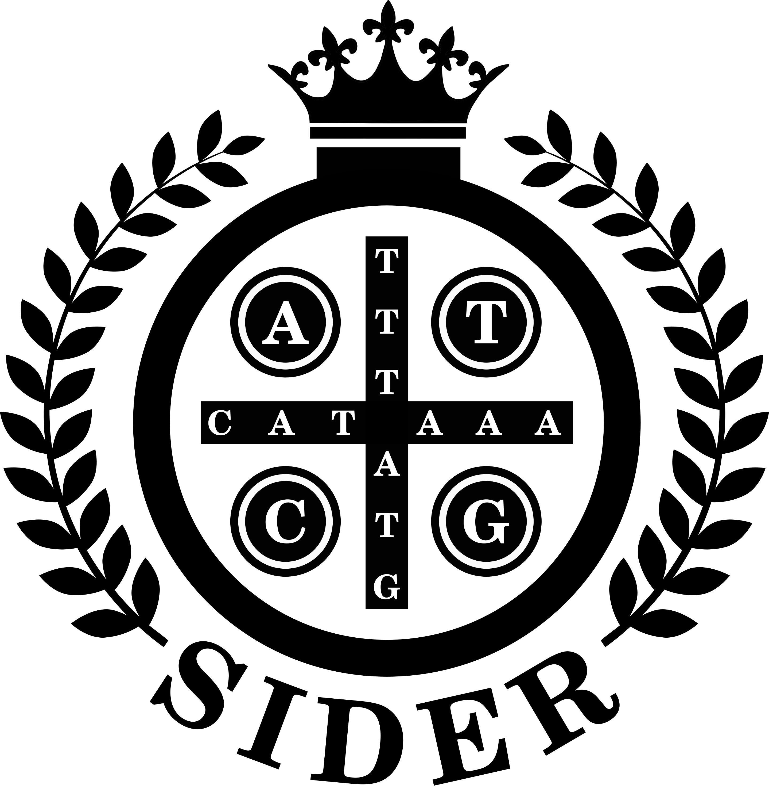

<p align="center">
  <a href="https://sideretro.readthedocs.io/en/latest/?badge=latest">
    <picture>
      <source media="(prefers-color-scheme: dark)" srcset="docs/images/logo_sideRETRO_dark.png">
      <source media="(prefers-color-scheme: light)" srcset="docs/images/logo_sideRETRO_light.png">
      
    </picture>
  </a>
</p>
<h2 align="center">A pipeline for detecting Somatic Insertion of DE novo RETROcopies</h2>

<p align="center">
  <a href="https://github.com/galantelab/sideRETRO/actions/workflows/ci.yml"></a>
  <a href="https://coveralls.io/github/galantelab/sideRETRO?branch=master"></a>
  <a href="https://sideretro.readthedocs.io/en/latest/?badge=latest"></a>
  <a href="https://github.com/galantelab/sideRETRO/tags/"></a>
  <a href="https://hub.docker.com/r/galantelab/sider/tags"></a>
</p>

**sideRETRO** is a bioinformatic tool devoted for the detection of somatic and polymorphic **retrocopy** insertions,
also known as **retroCNV**, in whole genome and whole exome sequencing data (WGS, WES). The program has been written
from scratch in C, and uses [HTSlib](http://www.htslib.org/) and [SQLite3](https://www.sqlite.org) libraries, in order
to manage **SAM/BAM/CRAM** reading and data analysis. It works with any gene annotation in **GTF/GFF3** or **BED**
format, and scales to large cohorts: The samples can be processed apart - even at different servers - and merged
at the end.

For full documentation, please visit <https://sideretro.readthedocs.io>.

### Features

When detecting retrocopies, **sideRETRO** can annotate several other features related to each event:

* **Parental gene**

   The gene which underwent retrotransposition process.

* **Genomic position**

   The genome coordinate where occurred the retrocopy integration event (chromosome:start-end).
   It includes the insertion point (the expected exact point of each retrocopy insertion).

* **Breakpoints and target site duplication**

   The exact junctions between the genome and the retrocopy, from the clipped reads, and the
   TSD - the few bases duplicated at both sides of the insertion - with its sequence.

* **Poly-A tail**

   The length of the poly-A tail observed in the reads, which also tells the strand of the insertion.

* **Exon-exon junctions**

   The reads spanning the junctions between the exons of the parental gene: direct evidence of a
   processed transcript, and of which isoform was retrocopied.

* **Retrocopy extent and sequence**

   Where the retrocopy begins and ends into its parental gene (the 5' truncation) and its predicted
   sequence, from the reference exons between the ends plus the poly-A.

* **Supporting reads**

   The names of the reads used to detect each event, by sample, and their role in the evidence (split read
   at a breakpoint, poly-A, exon-exon junction or discordant pair), so the evidence can be checked back at
   the alignment files.

* **Quality and filters**

   A quality score for each event and filters that check the hallmarks of a canonical retrocopy - TSD,
   poly-A and exon-exon junctions - so the high confidence events are just the ones that `PASS`.

* **Strandness**

   Detects the orientation of the insertion (+/-). It takes into account the orientation of insertion,
   whether in the leading (+) or lagging (-) DNA strand.

* **Genomic context**

   The retrocopy integration site context: If the retrotransposition event occurred at an intergenic or
   intragenic region - the latter can be splitted into exonic and intronic according to the host gene.

* **Genotype**

   When multiple individuals (genomes) are analyzed, **sideRETRO** discriminates events found in each one.
   That way, it is possible to distinguish whether an event is exclusive or shared among the cohort analyzed.

* **Haplotype**

   Our tool provides information about the ploidy of the event, i.e., whether it occurs in one or both homologous
   chromosomes (homozygous or heterozygous).

* **Any annotation**

   GENCODE by default, but any **GTF/GFF3** annotation - choosing the feature, the attributes to filter, the gene
   name and the exon id - or a **BED6** file of exons.

* **Large cohorts**

   Each `process-sample` run writes its own database, so the samples can be processed apart and merged by
   `merge-call`. The same sample is never merged twice, and the calls do not depend on how the samples were split.

## Getting Started

### Installation

The project depends on [Meson build system](https://mesonbuild.com) and [Ninja](https://github.com/ninja-build/ninja)
to manage configuration and compilation process. They can be obtained using package manager or from source. HTSlib,
SQLite3 and zlib are used from the system if found, otherwise they are downloaded and built with **sideRETRO**.
For example, using [Ubuntu](https://ubuntu.com) distribution:

```
$ sudo apt-get install python3 \
                       python3-pip \
                       python3-setuptools \
                       python3-wheel \
                       ninja-build
```

and then:

`$ pip3 install --user meson`

(or: `$ sudo apt install meson`)


Finally, clone this repository:

`$ git clone https://github.com/galantelab/sideRETRO.git`

Inside sideRETRO directory, run:

`$ meson setup build && meson compile -C build`

You can find `sider` executable inside `build/src`. Optionally, install to system directories with:

`$ sudo meson install -C build`

The tests (unit tests with [check](https://libcheck.github.io/check/) and simulated retrocopies through the
whole pipeline with Python 3) run with:

`$ meson test -C build`

### Docker

For Windows and macOS users - or anyone who does not want to build it - there is a
[Docker image](https://hub.docker.com/r/galantelab/sider):

`$ docker pull galantelab/sider`

The image runs `sider` itself, so just pass the subcommand and its options. The files must be reached
from inside the container, e.g. by mounting the current directory:

```sh
$ docker run --rm -v $(pwd):/data -w /data galantelab/sider \
    process-sample --annotation-file='my-annotation.gtf' --input-file='my-bam-list.txt'
```

### Usage

**sideRETRO** compiles to an executable called `sider`, which has three subcommands: `process-sample`, `merge-call`
and `make-vcf`. The `process-sample` subcommand processes a list of **SAM/BAM/CRAM** files, and captures abnormal reads
that must be related to an event of retrocopy. All those data is saved to a **SQLite3 database** and then we come
to the second step `merge-call`, which processes the database and annotates all the retrocopies found. Finally we
can run the subcommand `make-vcf` and generate a file (in **VCF** format) with retrocopies and further information
about them, alongside the list of supporting reads (TSV) and the predicted retrocopy sequences (FASTA).

```sh
# List of BAM files
$ cat 'my-bam-list.txt'
/path/to/file1.bam
/path/to/file2.bam
/path/to/file3.bam

# Run process-sample step
$ sider process-sample \
    --annotation-file='my-annotation.gtf' \
    --input-file='my-bam-list.txt'

$ ls -1
my-genome.fa
my-annotation.gtf
my-bam-list.txt
out.db

# Run merge-call step
$ sider merge-call --in-place \
    --reference-file='my-genome.fa' out.db

# Run make-vcf step
$ sider make-vcf \
    --reference-file='my-genome.fa' out.db
```

For large cohorts, process the samples in batches - at the same or at different servers - and merge them.
The alignment files must be reached at the same paths by `merge-call`, which genotypes the samples:

```sh
$ sider process-sample -a 'my-annotation.gtf' -p batch1 -i 'batch1.txt'
$ sider process-sample -a 'my-annotation.gtf' -p batch2 -i 'batch2.txt'
$ sider merge-call -r 'my-genome.fa' batch1.db batch2.db
$ sider make-vcf -r 'my-genome.fa' out.db
```

## Citation

If sideRETRO was somehow useful in your research, please cite it:

```bib
@article{10.1093/bioinformatics/btaa689,
  author = {Miller, Thiago L A and Orpinelli, Fernanda and Buzzo, José Leonel L and Galante, Pedro A F},
  title = "{sideRETRO: a pipeline for identifying somatic and polymorphic insertions of processed pseudogenes or retrocopies}",
  journal = {Bioinformatics},
  year = {2020},
  month = {07},
  issn = {1367-4803},
  doi = {10.1093/bioinformatics/btaa689},
  url = {https://doi.org/10.1093/bioinformatics/btaa689},
  note = {btaa689},
}
```

## License

This is free software, licensed under:

`The GNU General Public License, Version 3, June 2007`

