.. _chap_methodology:

***********
Methodology
***********

**sideRETRO** uses NGS (*Next Generation Sequencing*) data
to identify **unfixed** - *dimorphic/polymorphic, germinative,
or somatic* - retrocopies absent in the reference genome,
but present in the sequenced genome (by NGS).

Our **methodology** consists of detecting
abnormal (discordant) alignments in `SAM/BAM/CRAM
<https://samtools.github.io/hts-specs/SAMv1.pdf>`_
files and, with an **unsupervised machine learning**
algorithm, clustering these reads in order to discover
the retrocopy insertions. Then, each insertion is
described by the features that characterize a
retrocopy mobilization. In short:

1. Select the :ref:`abnormal alignments <method_abnormal>` with a
   mate at an exon (``process-sample``).
2. :ref:`Cluster <method_clustering>` them by insertion site and
   parental gene, and merge the clusters into retrocopies
   (``merge-call``).
3. Find the :ref:`breakpoints <method_breakpoints>` and the target site
   duplication, the :ref:`poly-A tail <method_polya>`, the
   :ref:`exon-exon junctions <method_junction>` and the
   :ref:`ends <method_ends>` of the retrocopy into its parental gene.
4. :ref:`Genotype <method_genotype>` each sample, looking for the
   :ref:`intron retention <method_intron>` on the way.
5. Score and filter the events (``make-vcf``), see :ref:`Quality and
   filters <method_filter>`.

.. note:: For more detail about the jargon, see `Retrocopy in a nutshell <retrocopy.rst>`_

.. _method_abnormal:

Abnormal alignment
==================

When a structural variation, such as a retrotransposition,
occurs into an individual and her genome is sequenced with
a next-generation sequencing technology (e.g. `illumina
<https://www.illumina.com/>`_), we may **expect** that the
aligner (e.g. `BWA <http://bio-bwa.sourceforge.net/>`_,
`Bowtie <http://bowtie-bio.sourceforge.net/index.shtml>`_)
will be **confused** as to the origin of certain reads. As the
retrocopies come from a **mature mRNA**, reads from the
retrocopy may be **erroneously** aligned to an **exon** of the
**parental gene**:

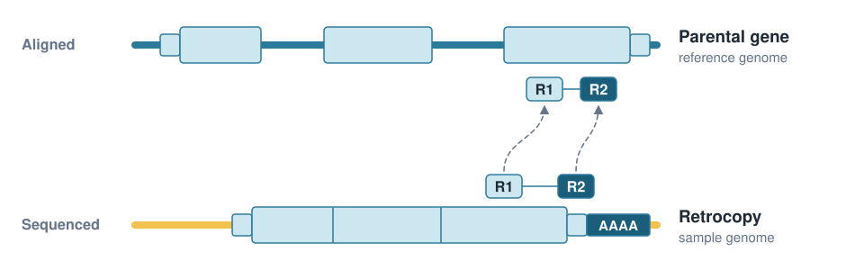

These kind of alignment may be called **indistinguishable**,
because they do not give any **clue** about the presence of
the retrocopy. However, for our luck, there are reads
with abnormal (discordant) alignments which could be
helpful according to their characteristics:

- Paired-end reads aligned at **different** exons
- Paired-end reads aligned at **different** chromosomes
- Paired-end reads aligned at **distant** regions
- Split reads (Reads with **supplementary** alignment)

We will talk about each one as best as we can in the
next lines.

Alignment at different exons
----------------------------

The paired-end reads are mapped to **contiguous exons**, with the
intron between them, although they came from a genomic sequencing -
which of course is not expected.

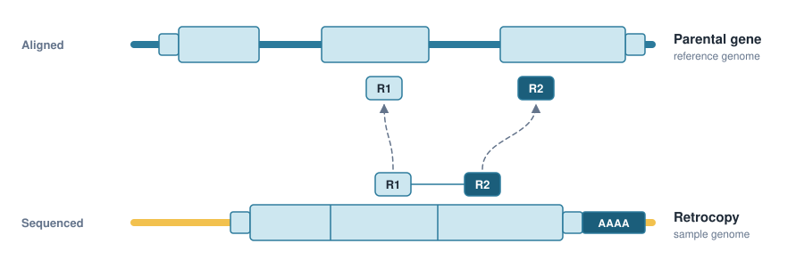

This kind of alignment is useful for **assume** a
retrotransposition for the given parental gene, however it
is not possible to annotate the **genomic position** of the event.

Alignment at different chromosomes
------------------------------------

When the retrotransposition does not occur into the **same** parental
gene chromosome, it may happen that one read come from a **near**
intergenic region and its pair from the somatic **retrocopy**. As the
retrocopy **does not exist** in the reference genome, the aligner will
**map** one read to the retrotransposition chromosome and its pair to
the parental gene **exon**.

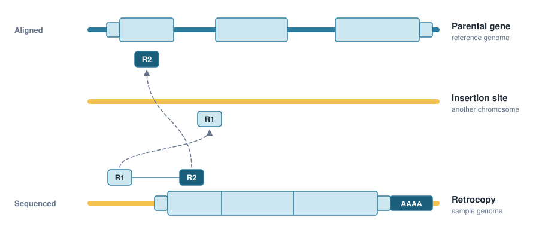

This alignment is useful to **estimate** the genomic position of the
event, but not with so much **precision** concerning to the **insertion
point**.

Alignment at distant regions
-----------------------------

If a retrocopy is inserted into the **same** chromosome of its parental
gene, possibly it will occur at a **distant** location. As well as
*"alignment at different chromosomes"*, one read may come from a near
intergenic region and its mate from the somatic retrocopy. So when
the aligner try to map these reads, we will observe that one fall
inside the parental gene exon, while its pair is mapped to a **distant
region**.

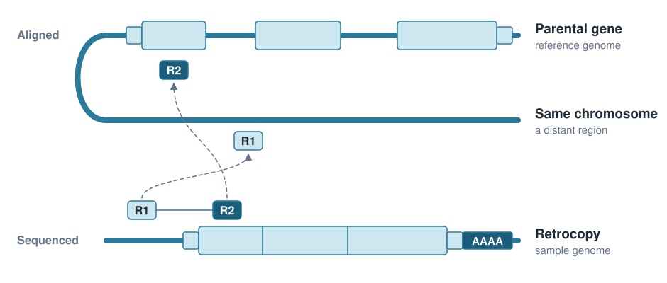

Split reads
-----------

The most **important** kind of alignment when detecting structural variations.
A split read occurs when **part** of the **same** read comes from a near
intergenic region and part from the somatic retrocopy. When the aligner
**tries** to map the read, it aligns one part and **clips** the other. If the
clipped part is long enough to be mapped elsewhere, the aligner **creates**
another alignment to represent it, which is called **supplementary**.

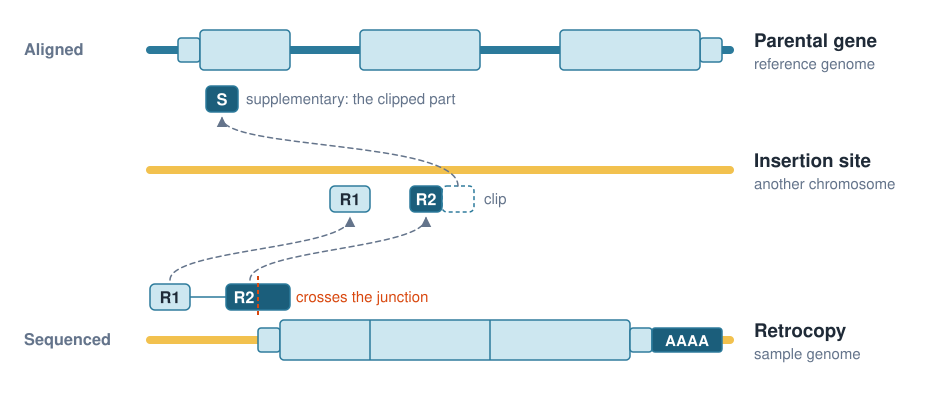

This alignment is useful to detect the **insertion point** with a
**good precision**. Note that a clipped read is useful even **without** a
supplementary alignment: The reads crossing the poly-A junction, for
instance, have a clip made of A which maps nowhere, see
:ref:`Breakpoints <method_breakpoints>`.

Taking all together
-------------------

We can resume all abnormal alignments according to their power
to detect the retrotransposition coordinate and its exact insertion
point:

+--------------------------+------------+-----------------+
| Abnormal alignments      | Coordinate | Insertion point |
+==========================+============+=================+
| At different exons       |     NO     |      NO         |
+--------------------------+------------+-----------------+
| At different chromosomes |     YES    |      NO         |
+--------------------------+------------+-----------------+
| At distant regions       |     YES    |      NO         |
+--------------------------+------------+-----------------+
| Split read               |     YES    |      YES        |
+--------------------------+------------+-----------------+

sideRETRO uses **only** the abnormal alignments **capable** to
detect **at least** the coordinate, so those that fall into
*different exons* are dismissed.

In practice, ``process-sample`` takes a fragment as abnormal when its
reads are at different chromosomes, farther than ``--max-distance``
from each other, or have a supplementary alignment. The reads must be
paired, mapped with the mate mapped, with the minimum mapping quality
(``--phred-quality``) and not of low complexity (``--max-base-freq``).
A single failing alignment drops the whole fragment, with one
exception: A **supplementary** alignment below the minimum mapping
quality, or of low complexity, is left out - not stored - and the
fragment is kept, still marked as a split read. The clip of a read
crossing the poly-A junction is often aligned as a short piece at a
random place - a run of A bases, with mapping quality 0 - and it
would take with it the read at the insertion site.
A fragment is **kept** only if one of its alignments overlaps an
**exon** of the annotation - by one base, or by the fractions given at
``--exon-frac`` and ``--alignment-frac``. A stricter fraction of the
alignment leaves out the reads crossing from an exon into its intron,
which do not come from a processed transcript.

.. _method_clustering:

Clustering
==========

So far we have been talking about abnormal reads **selection**. As
soon as this step is over, we need to determine if a bunch of
reads aligned to some genomic region may **represent** a putative
retrocopy insertion. Therefore, firstly we restrict the abnormal
reads for those whose **mate is mapped** to an **exon** of the
annotation - protein coding genes, by default - and then we
**cluster** them according to the chromosome they mapped to and to
the gene of their mates.

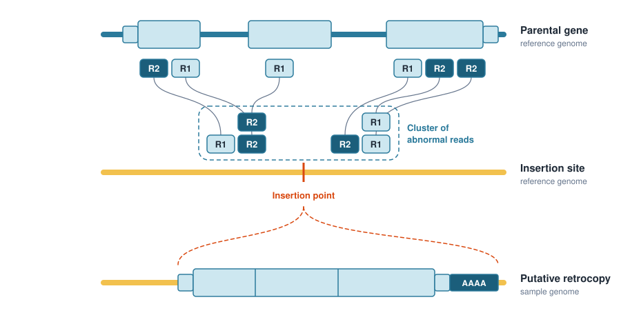

Wherefore, the clustering algorithm plays the role to resolve
if there really is a retrotransposition event. As the **number**
of reads **covering** the group is an important feature to take
into account, one possible choice of algorithm is **DBSCAN**.

DBSCAN
------

*Density Based Spatial Clustering of Applications with Noise* [1]_
is a density based clustering algorithm designed to discover cluster
in a **spatial database**. In our particular case, the database is
spatially of **one dimension** (the chromosome extension) and the
points are represented by the **range** comprising the mapped reads
start and end.

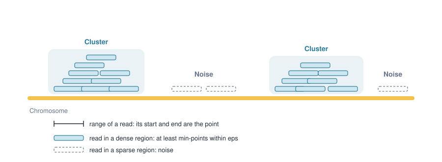

The denser (covered) the region the greater the chance of a
retrotransposition event there. Two reads are neighbours when they
are up to ``--epsilon`` bases apart, and a dense region needs
``--min-pts`` of them.

From clusters to retrocopies
----------------------------

Not every cluster is a retrocopy. ``merge-call`` discards the clusters:

- at a **blacklisted** chromosome or region - by default, the
  mitochondrial chromosome and the retrocopies already annotated at the
  reference, whose reads are abnormal for the same reason;
- too **near** their own parental gene (``--parental-distance``), as
  the reads of the gene itself;
- without enough reads from a **single sample**
  (``--genotype-support``).

The remaining clusters are compared to each other. Clusters at the same
site, from different genes, are **merged** into one retrocopy according
to their parental genes (``PGTYPE``):

+-------------------+-------------------------------------------------+
| Single            | No other cluster at the site                    |
+-------------------+-------------------------------------------------+
| Overlapped        | The parental genes overlap each other, see      |
| parental genes    | :ref:`Overlapped parental genes                 |
|                   | <method_overlapped>`                            |
+-------------------+-------------------------------------------------+
| Near parental     | The parental genes are neighbours, up to        |
| genes             | ``--near-gene-distance`` genes apart            |
+-------------------+-------------------------------------------------+
| Hotspot           | Unrelated parental genes: The clusters are not  |
|                   | merged, and there is one retrocopy for each     |
|                   | gene at the same site                           |
+-------------------+-------------------------------------------------+

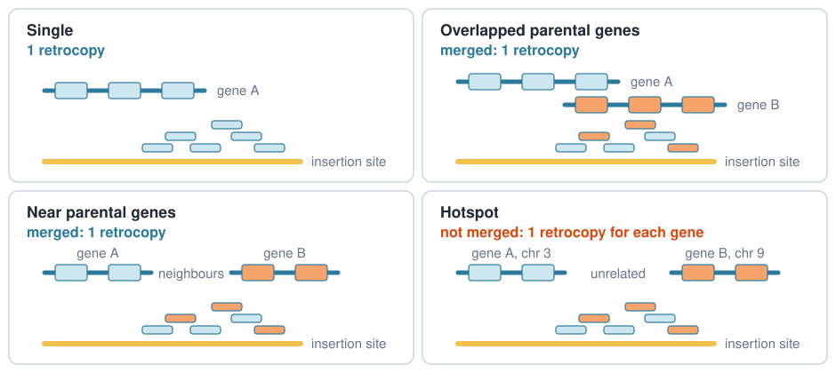

.. _method_genotype:

Genotype
========

In order to **increase** the putative insertion coverage, it is common
to **join** analysis of a bunch of individuals. After the discovery
of the retrocopies, it is necessary to identify **who owns** the
variation and with what **zygosity** (heterozygous, homozygous).
So we have **three** possibilities for biallelic sites [2]_: If *A*
is the **reference** allele and *B* is the **alternate** allele, the
ordering of genotypes for the likelihoods is *AA*, *AB*, *BB*. The
**likelihoods** in turn is calculated based on *Heng Li* paper [3]_
with some assumptions that we are going to discuss.

Suppose at a given retrotransposition insertion point site there are
*k* reads. Let the first *l* reads identical to the reference genome
and the rest be different. The unphred alignment error probability of
the *j*-th read is :math:`\epsilon_{j}`. Assuming error independence,
we can derive that:

.. math::
   \delta(g) =
   \frac{1}{m^k}
   \prod_{j=1}^{l} [(m-g)\epsilon_{j}+g(1-\epsilon_{j})]
   \prod_{j=l+1}^{k} [(m-g)(1-\epsilon_{j})+g\epsilon_{j}]

where:

+-------------------+--------------------------------------------+
| :math:`\delta(g)` | Likelihoods for a given genotype           |
+-------------------+--------------------------------------------+
| :math:`m`         | Ploidy                                     |
+-------------------+--------------------------------------------+
| :math:`g`         | Genotype (the number of reference alleles) |
+-------------------+--------------------------------------------+

.. note::
   The way we are modeling the likelihoods probability **differs** a little
   bit from the **SNP calling** model: We are **treating** the *read* as the
   **unit**, not the *base*, therefore the error (:math:`\epsilon`) is the
   **mapping** quality (fifth column of SAM file), instead of the
   **sequencing** quality.

The likelihoods are computed as :math:`\log_{10}`, summing the terms of
the products: At a deep site, :math:`1/2^k` itself would underflow to zero.
A read with mapping quality 0 is taken as mapping quality 1, otherwise
:math:`1-\epsilon_{j}` would be zero.

So we can summarize the formula for homozygous reference (HOR), heterozygous
(HET) and homozygous alternate (HOA):

HOR
  .. math::
     \delta(HOR) =
     \frac{1}{2^k}
     \prod_{j=1}^{l} 2(1-\epsilon_{j})
     \prod_{j=l+1}^{k} 2\epsilon_{j}

HET
  .. math::
     \delta(HET) =
     \frac{1}{2^k}

HOA
  .. math::
     \delta(HOA) =
     \frac{1}{2^k}
     \prod_{j=1}^{l} 2\epsilon_{j}
     \prod_{j=l+1}^{k} 2(1-\epsilon_{j})

We determine the insertion point site according to the abnormal alignments
clustering. Those *reads* will be used as the :math:`k - l` rest of the
*reads* which differs from reference genome. In order to verify if there
is evidence of reference allele, we need to come back to the SAM file and
check for the presence of *reads* **crossing** the insertion point. To
**mitigate** alignment error - which would otherwise overestimate the
number of reference allele *reads* - we select the *reads* that cover one
**decile** of *read* length window containing the insertion point. Then we
come to the :math:`l` *reads* **identical** to the reference genome and can
calculate the **genotype likelihoods**.

A *read* of the alternative allele aligns to the reference genome until
the junction, where it is clipped. With a target site duplication, the
TSD is present twice at the alternative allele, so these *reads* align
along the whole TSD before the clip, and would cover the insertion point.
Therefore, with both :ref:`breakpoints <method_breakpoints>`, a *read*
of the reference allele must cover the whole TSD - from the right to the
left breakpoint - plus the window. And a *read* clipped up to 5 bases
from a breakpoint - or, without the breakpoints, up to 25 bases from the
insertion point - is never taken for the reference allele.

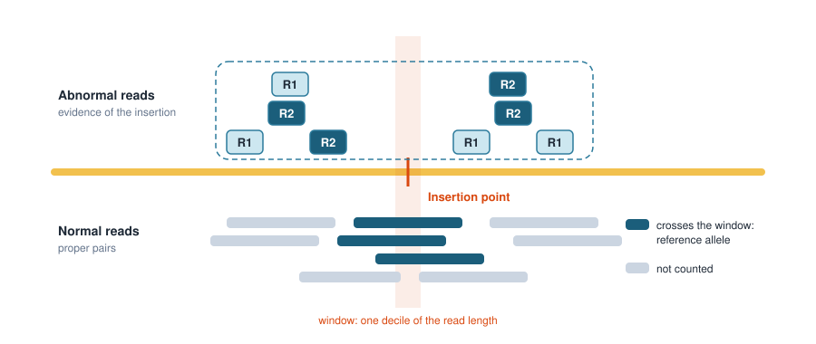

.. _method_orientation:

Orientation
===========

Other important information that can be obtained from the data is the
retrocopy **orientation** in relation to its parental gene - the
``POLARITY`` of the event. The abnormal alignment *reads* give us the
clue to solve this issue. We catch *reads*
when one pair aligns against an exon and its mate aligns to some genomic
region, so we can **sort** the *reads* from the exonic site and analyze
if their mates will be sorted in **ascending** or **descending** order as
result. If we observe that they are **directly** proportional, then we can
assume that the retrocopy is at the **same** parental gene strand, else they
are at **opposite** strands.

Only the **mate** of each *read* is used. A split *read* also has a piece
aligned to the parental gene, but it lies at the end of the retrocopy,
next to the junction, whatever the distance from the *read* to it: It
would count against the correlation.

.. warning::
   This approach disregards the fact that there may have been structural variations,
   such as chromosomal inversions, which may invalidate these results.

Therefore summarizing:

* Retrocopy and its parental gene are at the same strand

  .. image:: images/orientation_same_strand.svg
     :width: 90%
     :align: center

* Retrocopy and its parental gene are at opposite strands

  .. image:: images/orientation_opposite_strand.svg
     :width: 90%
     :align: center

Spearman's rank correlation coefficient
---------------------------------------

We use *Spearman's rank correlation coefficient* [4]_ in order to have a
**measure** of relationship between *reads* from exon and their mates from
clustering site.  As our data is **nonparametric**, the Spearman's rho can
assess **monotonic** relationship, that is, it can tell us if the genomic
position of *reads* from exon **increases** when **does** the genomic
position of their *mates* from clustering site (positive rho) - or the
opposite (negative rho).

So we come to the following proposition:

+----------------------+---------+---------+
|                      | Retrocopy strand  |
| Parental gene strand +---------+---------+
|                      | rho > 0 | rho < 0 |
+======================+=========+=========+
|         \+           |   \+    |   \-    |
+----------------------+---------+---------+
|         \-           |   \-    |   \+    |
+----------------------+---------+---------+

.. _method_breakpoints:

Breakpoints and target site duplication
=======================================

The clustering gives the **region** of the insertion. To find the
**exact** point, we turn to the reads crossing the junctions between the
genome and the retrocopy. Such a read is **clipped** by the aligner: One
part aligns to the flank and the other part - the clip - belongs to the
insertion. There are two junctions and, therefore, two **breakpoints**:

.. image:: images/breakpoints.svg
   :width: 100%
   :align: center

Left breakpoint (LBKP)
  The **last** reference base of the left flank. It comes from the reads
  clipped at their **right** side: The breakpoint is the last aligned
  base of the read.

Right breakpoint (RBKP)
  The **first** reference base of the right flank. It comes from the reads
  clipped at their **left** side: The breakpoint is the first aligned
  base of the read.

Each breakpoint is the **mode** of the positions given by its reads,
and the number of reads at the mode is its support (``LSR``, ``RSR``).
Clips shorter than 10 bases are ignored. Both **primary** and
**supplementary** clipped alignments count, with one safeguard: A
position is accepted if **at least two** clipped reads agree on it or if
a **single** read is a true split read - a fragment with a supplementary
alignment. Random clips, as adapters or quality trimming, land at random
positions and so can never define a breakpoint by themselves. Without an
accepted breakpoint, the insertion point is the **mean** of the cluster
window and the retrocopy is flagged ``IMPRECISE``.

Some points are worth stressing:

- Only the **side of the clip** matters. The strand of the retrocopy is
  not known at this step, and it is not needed: The two breakpoints are
  found the same way for both strands.
- The breakpoints are **reference coordinates** of the aligned part of
  the reads - the last aligned base (``LBKP``) and the first one
  (``RBKP``) - and not positions inside the clips.
- The two modes are chosen **independently**: Nothing assures that they
  come from the two ends of the same event (see
  :ref:`below <method_tsd_limits>`).
- The clipped reads are the ones **stored** by ``process-sample`` and
  clustered into the retrocopy: Fragments with a mate or a
  supplementary alignment at the exons of the parental gene. A clipped
  read whose mate is in the flank - a normal pair - is not seen. This
  makes the poly-A side harder: Its clip, made mostly of A, seldom has
  a supplementary alignment, so its reads are kept only when their
  mates fall into the retrocopy.

Retrocopies are inserted by the **LINE-1** machinery (see
:ref:`Retrocopy in a nutshell <chap_retrocopy>`), which cuts the two
strands of the target site at **staggered** positions. The repair fills
the single strand stretches, so the segment between the cuts ends up
**twice** at the inserted allele, one copy at each side of the
retrocopy: The **target site duplication** (TSD). As the figure shows,
the reads from the left flank cross the junction **after** the TSD,
while the reads from the right flank cross it **before** the TSD.

Why don't the two breakpoints coincide? Because each group of reads
carries **its own copy** of the TSD, and both copies align to the
**same** reference segment. For a TSD of 12 bases at the reference
positions 101 to 112:

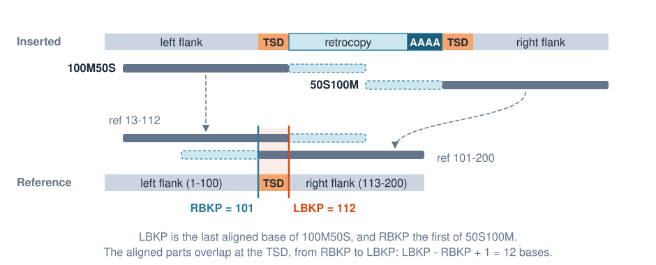

At the inserted allele, the ``100M50S`` read **enters** the event and the
``50S100M`` read **leaves** it. At the reference, the aligned part of the
first one ends to the **right** of where the second one begins, and the
overlap is the TSD: The segment from ``RBKP`` to ``LBKP``, of length
``LBKP - RBKP + 1``. The TSD sequence is then taken from the
**reference** (``make-vcf -r``), not from the reads.

The relation between the breakpoints tells what happened at the target
site:

+---------------------+-----------------------------+--------------------+
| Breakpoints         | Target site (``TSITE``)     | ``TSDLEN``         |
+=====================+=============================+====================+
| LBKP >= RBKP, by at | **Duplication** (``DUP``):  | At least           |
| least ``--min-tsd`` | The aligned parts overlap   | ``--min-tsd``      |
+---------------------+-----------------------------+--------------------+
| LBKP = RBKP - 1, or | **Blunt** insertion         | Zero, or positive  |
| a shorter overlap   | (``BLUNT``): The aligned    | below              |
|                     | parts meet, or overlap by a | ``--min-tsd``      |
|                     | few bases                   |                    |
+---------------------+-----------------------------+--------------------+
| LBKP < RBKP - 1     | **Deletion** (``DEL``): The | Negative: The      |
|                     | reference bases between the | deleted bases are  |
|                     | aligned parts are missing   | ``-TSDLEN``        |
+---------------------+-----------------------------+--------------------+

A target site **deletion** is not the loss of a TSD copy: There is no
TSD at all. The segment between the cuts is lost instead of being
copied, and the retrocopy takes its place. LINE-1 insertions with
deletions at the target site are known, from a few bases to many
kilobases, and blunt insertions happen as well.

A **short overlap** is not taken as a duplication. When the flank and
the retrocopy share a few bases at the junction - a microhomology -
the aligner may clip the reads at either side of them, and the
breakpoints overlap by those bases with no duplication at all. So an
overlap shorter than ``make-vcf --min-tsd`` (5 by default) is a blunt
insertion, with its measured ``TSDLEN`` kept at the VCF. The TSDs of
LINE-1 insertions are usually longer, from 7 to 20 bases.

So the three target sites are **valid**, and all of them pass the
filter: What fails is a retrocopy with a single breakpoint
(``OneBreakpoint``) or none (``NoBreakpoint``), whose target site is not
known. Only the length of a duplication is checked (``TSDOutlier``):
A long one usually comes from breakpoints of unrelated reads (see
:ref:`below <method_tsd_limits>`). A deletion longer than the cluster
window is not seen at a single retrocopy - see
:ref:`below <method_tsite_merged>`.

The insertion point reported at the VCF is the right breakpoint when it
is known, so the insertion is **left aligned**, with the TSD belonging to
the inserted allele. With a deletion, it is the first deleted base: As
VCF asks for a structural variant, ``POS`` is the base before the
**left-most** breakpoint.

The clipped sequences themselves are kept as the **observed** ends of the
insertion (``LEFT_SVINSSEQ``, ``RIGHT_SVINSSEQ``): A base by base
consensus of the clips, anchored at the junction.

.. _method_tsite_merged:

Long deletions at the target site
---------------------------------

A deletion at the target site may be as long as many kilobases. The two
flanks of a long one are farther apart than the clustering allows, so
each flank makes its **own** cluster - a retrocopy with a **single**
breakpoint, facing the other one:

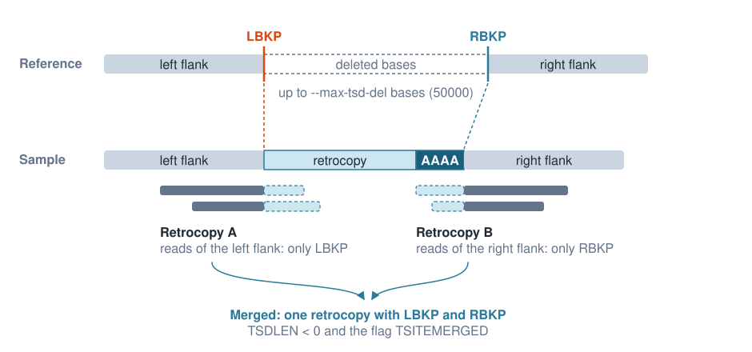

``merge-call`` merges such pairs into a single retrocopy, so that it is
genotyped as one insertion. Two retrocopies are merged only when all of
these hold:

- The same parental gene - a single one, not overlapped, near genes or a
  hotspot - and the same chromosome.
- A has only the left breakpoint and B only the right one, with
  ``LBKP < RBKP``, at most ``merge-call --max-tsd-del`` bases apart
  (default 50000).
- The strand agrees: A poly-A at both flanks - which means one strand at
  each - forbids it, and so does a significant orientation (``ORHO``) of
  opposite signs.
- The samples agree: At least one of them has reads at both flanks, and
  none has 5 or more fragments at one flank and nothing at the other.
- A and B are the **only** compatible retrocopies of each other: With
  more candidates, the deletion cannot be told, and both are kept as
  they are.

The merged retrocopy has both breakpoints, a negative ``TSDLEN`` and the
flag ``TSITEMERGED``, and its orientation is calculated again with the
reads of both flanks. A deletion shorter than the cluster window needs
none of this: Its flanks are already in the same retrocopy.

.. _method_tsd_limits:

What the TSD does not tell
--------------------------

The TSD is **inferred** from the geometry of the breakpoints: Two
boundaries, and the reference segment between them. It is not observed
as two copies in the reads, and the clips are not checked to hold the
parental gene. Most of the time the geometry is right, but a TSD too
long (``TSDOutlier``) usually means that the two groups of clipped reads
do not describe the two ends of the same event:

- **Hotspots** and low complexity regions, where clipped reads pile up
  at both sides for unrelated reasons, give long and arbitrary
  overlaps.
- **Mirror** clusters: A retrocopy inserted into an exon of another
  gene makes the reads of that gene look abnormal at the parental gene
  locus. There, the "breakpoints" are the ends of the exons, and the
  "TSD" the distance between them.
- **Local variation**: A small duplication or a change in the length of
  a tandem repeat near the site gives clipped reads of its own. Their
  clips are reference sequence, and the reads span the whole event.
- **Shifts**: When the TSD begins with A, the aligner cannot tell the
  tail from the flank and extends the alignment into the tail. A
  microhomology between the retrocopy and the flank does the same at
  the other side. The TSD becomes a few bases longer or shorter, and a
  short one may turn into a blunt insertion or a small deletion.

And the biology varies: Long TSDs also happen in real insertions. The
maximum (``make-vcf --max-tsd``) is a choice, not a law, and the clips
are kept at the VCF
(``LEFT_SVINSSEQ``, ``RIGHT_SVINSSEQ``) for you to judge: Those of a
retrocopy hold its ends - exon sequence or the tail - not the flanks.

.. _method_tsite_repeat:

Tandem repeats at the target site
---------------------------------

Inside a **tandem repeat**, the target site cannot be measured. The
reads may be clipped at any copy of the unit and still match the
reference, so the breakpoints slide along the repeat: A ``CA`` repeat
that slipped by a few copies looks exactly like a duplication of
those bases. And the reads of a repeat that changed length give
clipped reads by themselves, with mates wherever the repeat also
occurs - even in the exons of a gene with the same repeat.

So the reference is searched for a perfect tandem repeat at the
target site: A unit of 1 to 6 bases repeated at least 3 times, side
by side, along at least 10 bases, which touches the breakpoints or
the bases between them (3 bases of margin). The longest one is
reported at ``TSITETR``, as the unit and its span (``CA:34``). The
site is the segment between the breakpoints or the single breakpoint;
a deletion longer than 100 bases gives one site at each breakpoint.
With no breakpoint there is no site, and nothing is searched.
``TSITE`` and ``TSDLEN`` are still reported, but they are unreliable
when ``TSITETR`` is present.

.. _method_polya:

Poly-A tail and polarity
========================

A mature mRNA ends with a **poly-A tail**, and so does its retrocopy.
The tail sits at the **3' end** of the retrocopy, hence its side tells
the **strand** of the insertion:

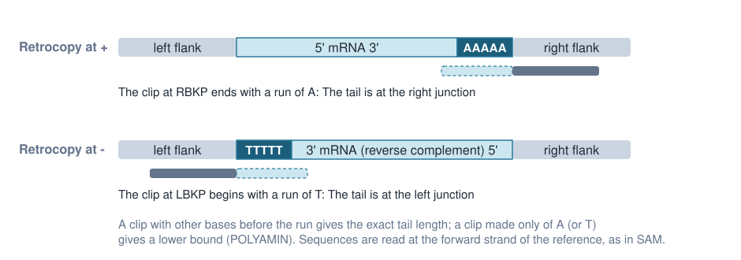

* Retrocopy at the **+** strand: The tail comes right before the right
  flank. The clips at ``RBKP`` **end** with a run of A.
* Retrocopy at the **-** strand: The retrocopy is reverse complemented, so
  the tail comes right after the left flank as a run of **T**. The clips
  at ``LBKP`` **begin** with it.

The clipped bases are read at the forward strand of the reference, as the
SAM format stores the read sequence - soft clips included - whatever the
strand of the read. So the run of A or T, and its side, do not depend on
the strand of the reads.

The tail is searched only where it can be - a run of A at the end of
the clips at the right junction, or of T at the beginning of the clips
at the left junction - and only in the reads clipped **exactly** at the
accepted breakpoint. So, without a breakpoint at its side, there is no
tail to find, and the hard clipped bases of a supplementary alignment
are not stored to be read. The strand is not chosen beforehand: Both
junctions are searched, and the tail tells it.

A run of at least 6 bases is called as the tail. It may begin up to 3
bases away from the flank: The aligner may shift the breakpoint, or
bases may be added at the junction. A read with other
bases **before** the run gives its **exact** length, while a clip made
only of A (or T) gives just a **lower bound** - the tail extends beyond the
read (``POLYAMIN``). Exact lengths win over lower bounds, and the strand
with more reads wins. Genomic A bases adjacent to the tail - at the end
of the last exon - cannot be told apart from it, so the length is
reported as observed.

When the tail is found, its strand is reported apart (``POLYASTRAND``),
while the ``POLARITY`` comes from the :ref:`orientation <method_orientation>`
correlation: Two independent signals, which may disagree. None of them
filters the event.

.. _method_overlapped:

Overlapped parental genes
=========================

Genes may **overlap** each other - often at opposite strands, tail to
tail - and share exonic bases. The *reads* of a retrocopy from one of
them fit both, so there is a cluster for each gene at the same site and
the parental gene is ambiguous (``PGTYPE=2``). Two signals may point to
**one** of the genes:

* **Fragments explained by one gene alone**: The mate overlaps an exon of
  this gene, but no exon of the others. A gene with at least 3 of them,
  when no other gene has any, is favoured.
* **Strand**: The poly-A gives the strand of the retrocopy at the reference
  (``POLYASTRAND``), while the :ref:`orientation <method_orientation>` gives
  it in relation to the parental gene. For genes at opposite strands, they
  agree for only one of them. It needs a poly-A and a significant
  orientation (p-value up to 0.05).

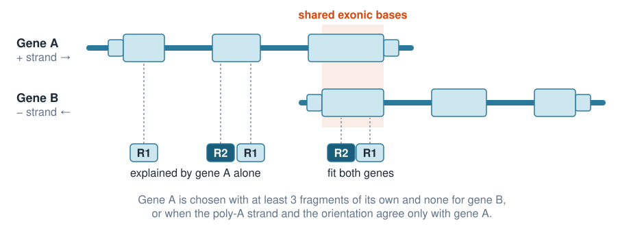

A gene is **chosen** when at least one signal favours it and none favours
another gene. It becomes the parental gene (``PG``), the others are listed
at ``PGALT`` and the event is not flagged as ``AmbiguousParental``. The
exon-exon junctions, the retrocopy ends and the predicted sequence come
from the chosen gene. If the signals disagree, or none applies - e.g. a
gene and its read-through transcript, with the same exons - the parental
gene stays ambiguous.

.. _method_junction:

Exon-exon junctions
===================

The strongest evidence that an insertion is a **processed** transcript -
and not, say, a segmental duplication - is a read spanning an
**exon-exon junction**: A sequence that exists in the mRNA, but not in
the genome. When such a read is aligned to the reference, the aligner
**splits** it into two pieces, one at each exon, and both pieces are
kept with the abnormal fragment.

So, for each retrocopy, we search its fragments for reads with **two
alignments** on **two different exons** of the parental gene. Exons of
different transcripts overlap, so the pieces of a read overlap many exon
pairs: The junction is the pair whose **boundaries** are met by the
pieces - the left one ends, clipped, at the end of the first exon and
the right one starts, clipped, at the start of the second exon. A piece
may stop up to 5 bases before the boundary (mismatches near the
junction), or go up to 10 bases beyond it: The sequence shared by the
end of one exon and the intron before the other (**microhomology**) is
aligned at both pieces. The closest pair wins.

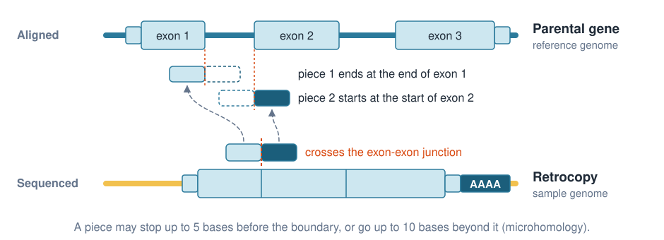

The junctions are counted at ``EEJ`` and listed at ``EEJLIST``, which
also tells **which isoform** was retrocopied when the gene has
alternative exons. The reads spanning them are at the read names file
(role ``junction``) and at the primer file. Only split reads count:
A discordant read at the insertion window, whose mate falls into one
exon, does not tell which exon comes next. No reference genome is
needed.

Beware of the parental genes with a **single exon**: They have no
exon-exon junction at all, so a missing ``EEJ`` is expected for them.
The number of exons of each parental gene is reported at ``PGEXONS`` for
this reason.

.. _method_intron:

Intron retention
================

Not every transcript is fully spliced. In tumor samples, mainly,
**intron retention** is common, and a transcript that kept an intron
can be retrocopied as any other. Such a retrocopy carries the intron
sequence, so some reads at the insertion have their mates **inside an
intron** of the parental gene, instead of at its exons.

Those fragments are not stored by ``process-sample``, which keeps the
abnormal fragments with an alignment at an exon. But ``merge-call``
reads the alignment files again for the :ref:`genotype
<method_genotype>`, and all the reads at the window of the retrocopy
pass by. Each one carries the **position of its mate**, so we take the
opportunity:

1. The **introns** of the parental gene are the gaps into the **union**
   of all its exons, so a region that is exon at any transcript is
   never intron. Each intron is named after the exons at its left and
   right.
2. A read at the window of the retrocopy is tested with the same
   quality control of the abnormal reads - paired, mapped with its mate
   mapped, not a duplication, with the mapping quality (``merge-call
   -Q``) and without a base overly frequent. Secondary and
   supplementary alignments are skipped, for they repeat the mate of
   the primary one.
3. Its mate must be **entirely inside** an intron of the parental gene
   of that retrocopy. A mate reaching an exon is not intronic.

The mate itself is not read. Its mapping quality and its end come from
the tags ``MQ`` and ``MC`` when the aligner wrote them; otherwise, the
mate is taken with the quality and the length of the read at the
window.

The reads are counted by retrocopy, sample and intron. Then,
``make-vcf`` reports an intron when **at least one sample** has enough
reads at it (``--min-ir``, 2 by default): The introns at ``IRLIST`` and
the sum of their reads at ``IR``.

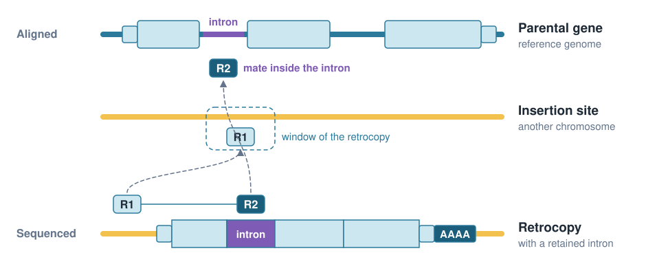

.. note::
   The intron retention is an **annotation**, not a filter. It may be
   the biology of the sample, as said, and it may also be a sign that
   the event is not a retrocopy at all - a duplication of the gene
   carries its introns too. The breakpoints and the target site
   duplication tell them apart, so they do the filtering.

.. _method_ends:

Retrocopy ends and predicted sequence
=====================================

With the reference genome (``merge-call -r``), the clipped
sequences at the junctions can tell **where** the retrocopy begins and
ends into its parental gene:

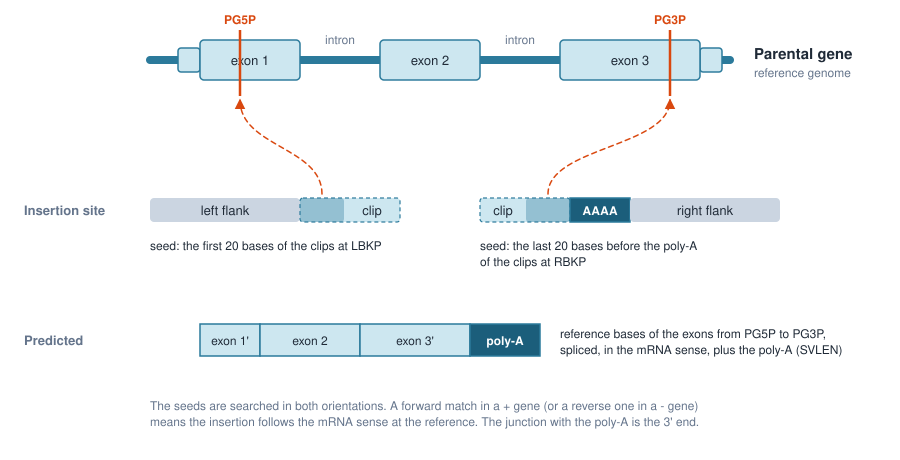

A **seed** of up to 20 bases is taken from each clip - from the
beginning of the clips at ``LBKP``, and from the end of the clips at
``RBKP``, before the poly-A - and searched, in both orientations, into
the exon sequences of the parental gene. Seeds matching more than one
place are discarded as ambiguous. Each match gives a **position** into
the gene and whether the insertion follows the **mRNA sense** at the
reference: A forward match in a + gene, or a reverse complement match
in a - gene. If so, the left junction is the **5' end** of the
retrocopy and the right junction is the **3' end**; otherwise they are
swapped. When there is a **poly-A**, it tells the sense by itself: Its
junction is the 3' end. The matches decide - by majority - only without
it, as an inverted piece at the 5' end of the retrocopy matches at the
other sense. Again, the ends are the modes over the reads (``PG5P``,
``PG3P``). A 5' end inside the transcript means a **5' truncated**
retrocopy, which is common: The reverse transcription often stops
before reaching the 5' end of the mRNA.

From the 5' end, the inserted sequence is **predicted**: The reference
bases of the exons between the ends - with alternative exons merged -
in the mRNA sense, plus the poly-A with its observed length. When the
3' end was not observed, it is assumed at the end of the last exon.
Its length is reported as ``SVLEN`` and the sequence is written to
the :ref:`insertions file <insertions_file>`.

.. warning::
   The junctions and the poly-A are **observed**; the body of the
   insertion is **predicted** from the reference. The prediction is
   right when the retrocopy copied the annotated exons faithfully, and
   knows nothing about variants of the parental allele, mutations
   acquired after the insertion or unannotated isoforms. This is also
   why the VCF keeps a **symbolic** ALT allele.

.. _method_filter:

Quality and filters
===================

At last, ``make-vcf`` gives each retrocopy a **quality** and a
**filter**.

The quality (``QUAL``) is the confidence that the insertion is **real**
- that at least one sample carries it. It comes from the
:ref:`genotype <method_genotype>` likelihoods, which are already
calculated for each sample *i*: :math:`\delta_i(HOR)`,
:math:`\delta_i(HET)` and :math:`\delta_i(HOA)`. With no preference
for any genotype beforehand (a flat prior), the probability that the
sample **does not** carry the insertion is the share of the homozygous
reference among them:

.. math::
   P_i(HOR) =
   \frac{\delta_i(HOR)}{\delta_i(HOR) + \delta_i(HET) + \delta_i(HOA)}

The site is not variant only if **all** the *n* samples are homozygous
reference. Taking the samples as independent, the probabilities are
multiplied, and ``QUAL`` is the result at the Phred scale:

.. math::
   QUAL =
   -10 \log_{10} \prod_{i=1}^{n} P_i(HOR) =
   \sum_{i=1}^{n} -10 \log_{10} P_i(HOR)

So each sample **adds** its own evidence. A carrier adds a lot, and a
sample at the reference adds almost nothing. For instance, with the
likelihoods (``GL``, at :math:`\log_{10}`) of two samples:

+----------+----------------------+-------------------------+----------+
| Sample   | GL (HOR, HET, HOA)   | :math:`P_i(HOR)`        | Adds     |
+==========+======================+=========================+==========+
| Carrier  | -30.0, -1.5, -0.1    | :math:`1.2 \times       | 299.2    |
|          |                      | 10^{-30}`               |          |
+----------+----------------------+-------------------------+----------+
| Reference| -0.1, -3.0, -30.0    | 0.9987                  | 0.0      |
+----------+----------------------+-------------------------+----------+

and ``QUAL`` is 299.2. Some details:

- The samples **without reads** at the site are not informative, and
  they are skipped. Without any informative sample, ``QUAL`` is missing
  (``.``).
- The sum is done with the likelihoods at :math:`\log_{10}`, as they
  are stored, so deep sites do not underflow.
- ``QUAL`` is capped at 999.
- It inherits the genotype model, which counts the reads weighted by
  their mapping quality: A score to **rank** the insertions, not a
  calibrated probability.

The filter (``FILTER``) asks whether the **insertion point**
is well defined, so that a ``PASS`` retrocopy is a good target for
validation: Enough split reads and both breakpoints - a duplication not
too long, a blunt insertion or a deletion at the target site - besides
the quality, the mapping quality of the reads and a single parental
gene.

It also asks for **one hallmark** of retrotransposition, whichever: An
exon-exon junction, the poly-A tail or a target site duplication
(``NoHallmark``). Each one depends on the coverage and on where the
retrocopy was cut, so none of them is required alone. But an event
without any of them cannot be told from an unprocessed copy of the
gene, or from a tandem repeat that changed length. A duplication inside
a tandem repeat does not count (see :ref:`Tandem repeats
<method_tsite_repeat>`), unless the repeat is a run of A or T: LINE-1
cuts at T-rich sites. And it must be at a **primary chromosome**
(``NonPrimary``): Alt, decoy, unplaced and HLA contigs copy regions of
the primary chromosomes or are too short for both flanks, and their
names vary among the references - so the primary ones are given as a
regular expression (``make-vcf -P``). The intron retention is
**reported**, but it does not filter. See :ref:`QUAL <qual>` and :ref:`FILTER <filter>` for the
details and the thresholds.

References and Further Reading
==============================

.. [1] Ester, Martin. (1996).
   A Density-Based Algorithm for Discovering Clusters in Large Spatial Databases with Noise.
   KDD. Available at https://www.aaai.org/Papers/KDD/1996/KDD96-037.pdf.

.. [2] hts-specs. (2019).
   The Variant Call Format (VCF) Version 4.2 Specification.
   Available at https://samtools.github.io/hts-specs/VCFv4.2.pdf.

.. [3] Li, Heng (2011).
   A statistical framework for SNP calling, mutation discovery, association mapping and
   population genetical parameter estimation from sequencing data.
   Oxford University Press.

.. [4] Fieller, E. C., et al. (1957).
   Tests for Rank Correlation Coefficients. I.
   Biometrika, 44(3/4), 470–481. JSTOR.
   Available at https://www.jstor.org/stable/2332878.
