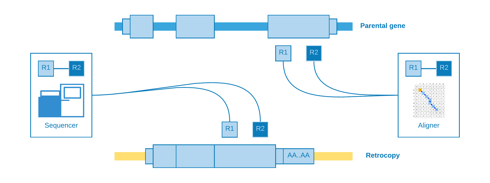
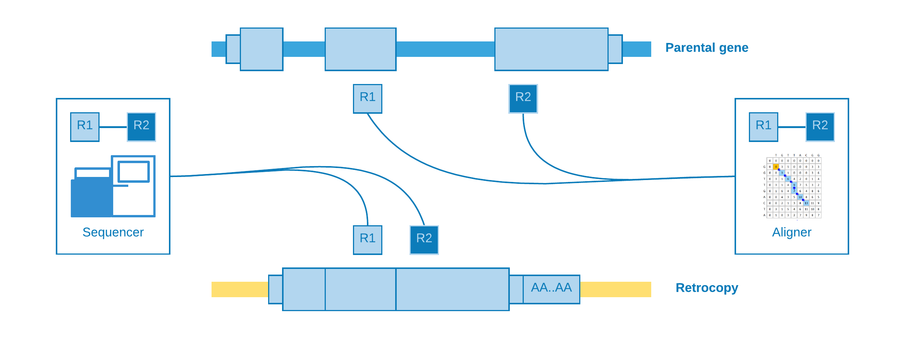
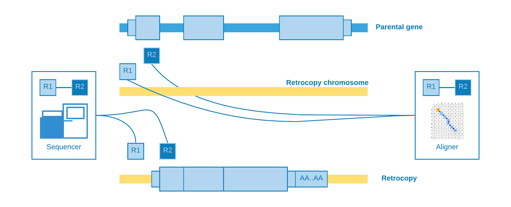
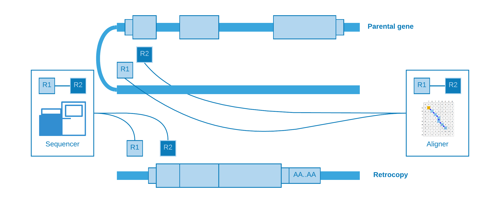
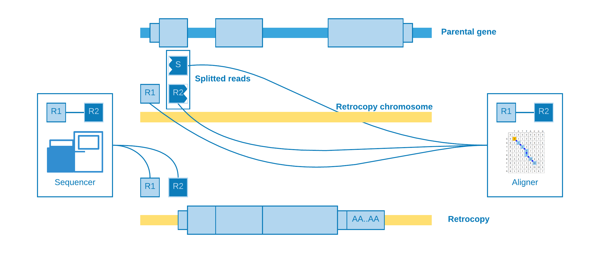
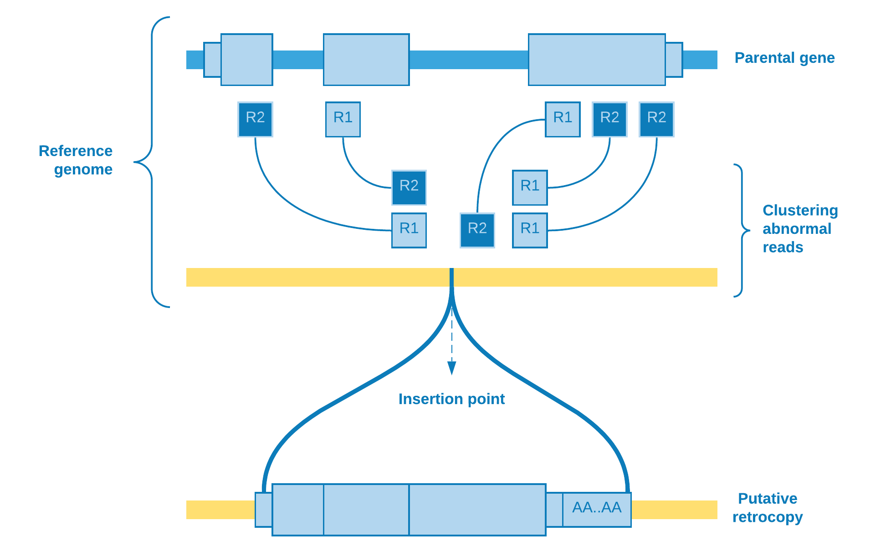
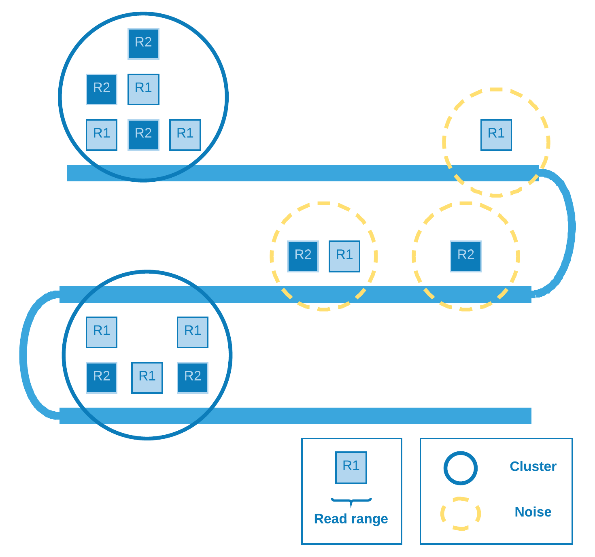
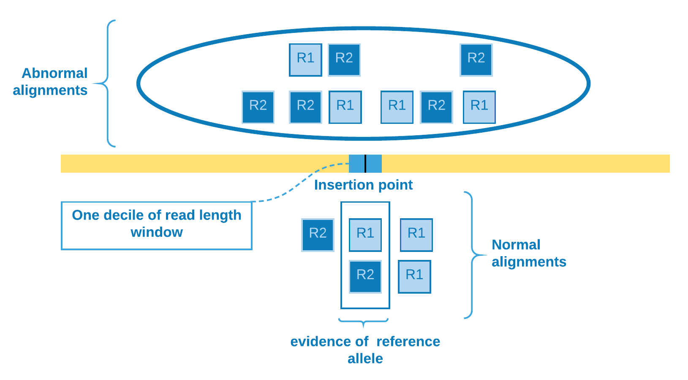
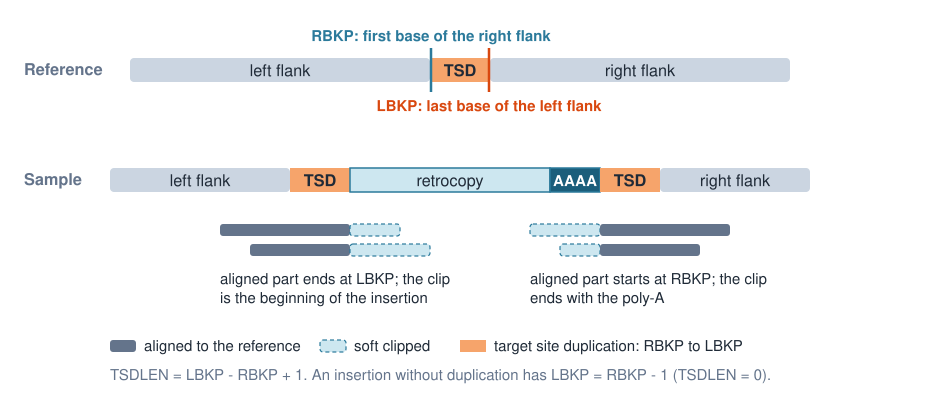

.. _chap_methodology:

***********
Methodology
***********

**siderRETRO** uses NGS (*Next Generation Sequencing*) data
to identify **unfixed** - *dimorphic/polymorphic, germinative,
or somatic* - retrocopies absent in the reference genome,
but present in the sequenced genome (by NGS).

Our **methodology** consists of detecting
abnormal (discordant) alignments in `SAM/BAM/CRAM
<https://samtools.github.io/hts-specs/SAMv1.pdf>`_
file and, with an **unsupervised machine learning**
algorithm, clustering these reads and genotype in order
to discover somatic retrocopy insertions. Care is taken
to ensure the quality and consistency of the data,
taking into account the features that characterize a
retrocopy mobilization, such as the absence of
**intronic** and **regulatory** regions.

.. note:: For more detail about the jargon, see `Retrocopy in a nutshell <retrocopy.rst>`_

Abnormal alignment
==================

When a structural variation, such as a retrotransposition,
occurs into an individual and her genome is sequenced with
a next-generation sequencing technology (e.g. `illumina
<https://www.illumina.com/>`_), we may **expect** that the
aligner (e.g. `BWA <http://bio-bwa.sourceforge.net/>`_,
`Bowtie <http://bowtie-bio.sourceforge.net/index.shtml>`_)
will be **confused** as to the origin of certain reads. As the
retrocopies come from a **mature mRNA**, reads from the
retrocopy may be **erroneously** aligned to an **exon** of the
**parental gene**:

These kind of alignment may be called **indistinguishable**,
because they do not give any **clue** about the presence of
the retrocopy. However, for our luck, there are reads
with abnormal (discordant) alignments which could be
helpful according to their characteristics:

- Paired-end reads aligned at **different** exons
- Paired-end reads aligned at **different** chromosomes
- Paired-end reads aligned at **distant** regions
- Splitted reads (Reads with **supplementary** alignment)

We will talk about each one as best as we can in the
next lines.

Alignment at different exons
----------------------------

When paired-end reads are mapped to contiguous exons and they
came from a genomic sequencing - which of course is not
expected.

This kind of alignment is useful for **assume** a
retrotransposition for the given parental gene, however it
is not possible to annotate the **genomic position** of the event.

Alignment at different chromosomes
------------------------------------

When the retrotransposition does not occur into the **same** parental
gene chromosome, it may happen that one read come from a **near**
intergenic region and its pair from the somatic **retrocopy**. As the
retrocopy **does not exist** in the reference genome, the aligner will
**map** one read to the retrotransposition chromosome and its pair to
the parental gene **exon**.

This alignment is useful to **estimate** the genomic position of the
event, but not with so much **precision** concerning to the **insertion
point**.

Alignment at distant regions
-----------------------------

If a retrocopy is inserted into the **same** chromosome of its parental
gene, possibly it will occur at a **distant** location. As well as
*"alignment at different chromosomes"*, one read may come from a near
intergenic region and its mate from the somatic retrocopy. So when
the aligner try to map these reads, we will observe that one fall
inside the parental gene exon, while its pair is mapped to a **distant
region**.

Split reads
-----------

The most **important** kind of alignment when detecting structural variations.
A split read occurs when **part** of the **same** read comes from a near
intergenic region and part from the somatic retrocopy. When the aligner
**tries** to map the read, it aligns one part and **clips** the other. If the
clipped part is long enough to be mapped elsewhere, the aligner **creates**
another alignment to represent it, which is called **supplementary**.

This alignment is useful to detect the **insertion point** with a
**good precision**. Note that a clipped read is useful even **without** a
supplementary alignment: The reads crossing the poly-A junction, for
instance, have a clip made of A which maps nowhere, see
:ref:`Breakpoints <method_breakpoints>`.

Taking all together
-------------------

We can resume all abnormal alignments according to their power
to detect the retrotransposition coordinate and its exact insertion
point:

+--------------------------+------------+-----------------+
| Abnormal alignments      | Coordinate | Insertion point |
+==========================+============+=================+
| At different exons       |     NO     |      NO         |
+--------------------------+------------+-----------------+
| At different chromosomes |     YES    |      NO         |
+--------------------------+------------+-----------------+
| At distant regions       |     YES    |      NO         |
+--------------------------+------------+-----------------+
| Split read               |     YES    |      YES        |
+--------------------------+------------+-----------------+

sideRETRO uses **only** the abnormal alignments **capable** to
detect **at least** the coordinate, so those that fall into
*different exons* are dismissed.

Clustering
==========

So far we have been talking about abnormal reads **selection**. As
soon as this step is over, we need to determine if a bunch of
reads aligned to some genomic region may **represent** a putative
retrocopy insertion. Therefore, firstly we restrict the abnormal
reads for those whose **mate is mapped** to a protein coding **exon**,
and then we **cluster** them according to the chromosome they mapped
to.

Wherefore, the clustering algorithm plays the role to resolve
if there really is a retrotransposition event. As the **number**
of reads **covering** the group is an important feature to take
into account, one possible choice of algorithm is **DBSCAN**.

DBSCAN
------

*Density Based Spatial Clustering of Applications with Noise* [1]_
is a density based clustering algorithm designed to discover cluster
in a **spatial database**. In our particular case, the database is
spatially of **one dimension** (the chromosome extension) and the
points are represented by the **range** comprising the mapped reads
start and end.

The denser (covered) the region the greater the chance of a
retrotransposition event there.

.. _method_genotype:

Genotype
========

In order to **increase** the putative insertion coverage, it is common
to **join** analysis of a bunch of individuals. After the discovery
of the retrocopies, it is necessary to identify **who owns** the
variation and with what **zygosity** ((heterozygous, homozygous).
So we have **three** possibilities for biallelic sites [2]_: If *A*
is the **reference** allele and *B* is the **alternate** allele, the
ordering of genotypes for the likelihoods is *AA*, *AB*, *BB*. The
**likelihoods** in turn is calculated based on *Heng Li* paper [3]_
with some assumptions that we are going to discuss.

Suppose at a given retrotransposition insertion point site there are
*k* reads. Let the first *l* reads identical to the reference genome
and the rest be different. The unphred alignment error probability of
the *j*-th read is :math:`\epsilon_{j}`. Assuming error independence,
we can derive that:

.. math::
   \delta(g) =
   \frac{1}{m^k}
   \prod_{j=1}^{l} [(m-g)\epsilon_{j}+g(1-\epsilon_{j})]
   \prod_{j=l+1}^{k} [(m-g)(1-\epsilon_{j})+g\epsilon_{j}]

where:

+-------------------+--------------------------------------------+
| :math:`\delta(g)` | Likelihoods for a given genotype           |
+-------------------+--------------------------------------------+
| :math:`m`         | Ploidy                                     |
+-------------------+--------------------------------------------+
| :math:`g`         | Genotype (the number of reference alleles) |
+-------------------+--------------------------------------------+

.. note::
   The way we are modeling the likelihoods probability **differs** a little
   bit from the **SNP calling** model: We are **treating** the *read* as the
   **unit**, not the *base*, therefore the error (:math:`\epsilon`) is the
   **mapping** quality (fifth column of SAM file), instead of the
   **sequencing** quality.

The likelihoods are computed as :math:`\log_{10}`, summing the terms of
the products: At a deep site, :math:`1/2^k` itself would underflow to zero.
A read with mapping quality 0 is taken as mapping quality 1, otherwise
:math:`1-\epsilon_{j}` would be zero.

So we can summarize the formula for homozygous reference (HOR), heterozygous
(HET) and homozygous alternate (HOA):

HOR
  .. math::
     \delta(HOR) =
     \frac{1}{2^k}
     \prod_{j=1}^{l} 2(1-\epsilon_{j})
     \prod_{j=l+1}^{k} 2\epsilon_{j}

HET
  .. math::
     \delta(HET) =
     \frac{1}{2^k}

HOA
  .. math::
     \delta(HOA) =
     \frac{1}{2^k}
     \prod_{j=1}^{l} 2\epsilon_{j}
     \prod_{j=l+1}^{k} 2(1-\epsilon_{j})

We determine the insertion point site according to the abnormal alignments
clustering. Those *reads* will be used as the :math:`k - l` rest of the
*reads* which differs from reference genome. In order to verify if there
is evidence of reference allele, we need to come back to the SAM file and
check for the presence of *reads* **crossing** the insertion point. To
**mitigate** alignment error - which would otherwise overestimate the
number of reference allele *reads* - we select the *reads* that cover one
**decile** of *read* length window containing the insertion point. Then we
come to the :math:`l` *reads* **identical** to the reference genome and can
calculate the **genotype likelihoods**.

.. _method_orientation:

Orientation
===========

Other important information that can be obtained from the data is the
retrocopy **orientation** in relation to its parental gene - the
``POLARITY`` of the event. The abnormal alignment *reads* give us the
clue to solve this issue. We catch *reads*
when one pair aligns against an exon and its mate aligns to some genomic
region, so we can **sort** the *reads* from the exonic site and analyze
if their mates will be sorted in **ascending** or **descending** order as
result. If we observe that they are **directly** proportional, then we can
assume that the retrocopy is at the **same** parental gene strand, else they
are at **opposite** strands.

Only the **mate** of each *read* is used. A split *read* also has a piece
aligned to the parental gene, but it lies at the end of the retrocopy,
next to the junction, whatever the distance from the *read* to it: It
would count against the correlation.

.. warning::
   This approach disregards the fact that there may have been structural variations,
   such as chromosomal inversions, which may invalidate these results.

Therefore summarizing:

* Retrocopy and its parental gene are at the same strand

  .. image:: images/orientation_same_strand.png
     :scale: 25%
     :align: center

* Retrocopy and its parental gene are at opposite strands

  .. image:: images/orientation_opposite_strand.png
     :scale: 25%
     :align: center

Spearman's rank correlation coefficient
---------------------------------------

We use *Spearman's rank correlation coefficient* [4]_ in order to have a
**measure** of relationship between *reads* from exon and their mates from
clustering site.  As our data is **nonparametric**, the Spearman's rho can
assess **monotonic** relationship, that is, it can tell us if the genomic
position of *reads* from exon **increases** when **does** the genomic
position of their *mates* from clustering site (positive rho) - or the
opposite (negative rho).

So we come to the following proposition:

+----------------------+---------+---------+
|                      | Retrocopy strand  |
| Parental gene strand +---------+---------+
|                      | rho > 0 | rho < 0 |
+======================+=========+=========+
|         \+           |   \+    |   \-    |
+----------------------+---------+---------+
|         \-           |   \-    |   \+    |
+----------------------+---------+---------+

.. _method_breakpoints:

Breakpoints and target site duplication
=======================================

The clustering gives the **region** of the insertion. To find the
**exact** point, we turn to the reads crossing the junctions between the
genome and the retrocopy. Such a read is **clipped** by the aligner: One
part aligns to the flank and the other part - the clip - belongs to the
insertion. There are two junctions and, therefore, two **breakpoints**:

Left breakpoint (LBKP)
  The **last** reference base of the left flank. It comes from the reads
  clipped at their **right** side: The breakpoint is the last aligned
  base of the read.

Right breakpoint (RBKP)
  The **first** reference base of the right flank. It comes from the reads
  clipped at their **left** side: The breakpoint is the first aligned
  base of the read.

Each breakpoint is the **mode** of the positions given by its reads,
and the number of reads at the mode is its support (``LSR``, ``RSR``).
Clips shorter than 10 bases are ignored. Both **primary** and
**supplementary** clipped alignments count, with one safeguard: A
position is accepted if **at least two** clipped reads agree on it or if
a **single** read is a true split read - a fragment with a supplementary
alignment. Random clips, as adapters or quality trimming, land at random
positions and so can never define a breakpoint by themselves. Without an
accepted breakpoint, the insertion point is the **mean** of the cluster
window and the retrocopy is flagged ``IMPRECISE``.

Retrocopies are inserted by the **LINE-1** machinery (see
:ref:`Retrocopy in a nutshell <chap_retrocopy>`), which **duplicates** a
few bases of the target site at both sides of the insertion: The
**target site duplication** (TSD). As the figure shows, the reads from
the left flank cross the junction **after** the TSD, while the reads from
the right flank cross it **before** the TSD. So, at the reference, the
TSD is the segment from ``RBKP`` to ``LBKP`` and its length is
``LBKP - RBKP + 1``: Positive for a duplication, zero for a clean
insertion and negative when some bases were **deleted** at the target
site. The insertion point reported at the VCF is the right breakpoint
when it is known, so the insertion is **left aligned**, with the TSD
belonging to the inserted allele.

The clipped sequences themselves are kept as the **observed** ends of the
insertion (``LEFT_SVINSSEQ``, ``RIGHT_SVINSSEQ``): A base by base
consensus of the clips, anchored at the junction.

.. _method_polya:

Poly-A tail and polarity
========================

A mature mRNA ends with a **poly-A tail**, and so does its retrocopy.
The tail sits at the **3' end** of the retrocopy, hence its side tells
the **strand** of the insertion:

.. image:: images/polya_polarity.svg
   :width: 100%
   :align: center

* Retrocopy at the **+** strand: The tail comes right before the right
  flank. The clips at ``RBKP`` **end** with a run of A.
* Retrocopy at the **-** strand: The retrocopy is reverse complemented, so
  the tail comes right after the left flank as a run of **T**. The clips
  at ``LBKP`` **begin** with it.

The clipped bases are read at the forward strand of the reference, as the
SAM format stores the read sequence - soft clips included - whatever the
strand of the read. So the run of A or T, and its side, do not depend on
the strand of the reads.

A run of at least 6 bases is called as the tail. It may begin up to 3
bases away from the flank: The aligner may shift the breakpoint, or
bases may be added at the junction. A read with other
bases **before** the run gives its **exact** length, while a clip made
only of A (or T) gives just a **lower bound** - the tail extends beyond the
read (``POLYAMIN``). Exact lengths win over lower bounds, and the strand
with more reads wins. Genomic A bases adjacent to the tail - at the end
of the last exon - cannot be told apart from it, so the length is
reported as observed.

When the tail is found, its strand is reported apart (``POLYASTRAND``),
while the ``POLARITY`` comes from the :ref:`orientation <method_orientation>`
correlation: Two independent signals, which may disagree. None of them
filters the event.

Exon-exon junctions
===================

The strongest evidence that an insertion is a **processed** transcript -
and not, say, a segmental duplication - is a read spanning an
**exon-exon junction**: A sequence that exists in the mRNA, but not in
the genome. When such a read is aligned to the reference, the aligner
**splits** it into two pieces, one at each exon, and both pieces are
kept with the abnormal fragment.

So, for each retrocopy, we search its fragments for reads with **two
alignments** overlapping **two different exons** of the parental gene.
The reads are counted at ``EEJ`` and the junctions listed at ``EEJLIST``,
which also tells **which isoform** was retrocopied when the gene has
alternative exons. No reference genome is needed.

Beware of the parental genes with a **single exon**: They have no
exon-exon junction at all, so a missing ``EEJ`` is expected for them.
The number of exons of each parental gene is reported at ``PGEXONS`` for
this reason.

Retrocopy ends and predicted sequence
=====================================

With the reference genome at hand (``merge-call -r``), the clipped
sequences at the junctions can tell **where** the retrocopy begins and
ends into its parental gene:

.. image:: images/retrocopy_ends.svg
   :width: 100%
   :align: center

A **seed** of up to 20 bases is taken from each clip - from the
beginning of the clips at ``LBKP``, and from the end of the clips at
``RBKP``, before the poly-A - and searched, in both orientations, into
the exon sequences of the parental gene. Seeds matching more than one
place are discarded as ambiguous. Each match gives a **position** into
the gene and whether the insertion follows the **mRNA sense** at the
reference: A forward match in a + gene, or a reverse complement match
in a - gene. If so, the left junction is the **5' end** of the
retrocopy and the right junction is the **3' end**; otherwise they are
swapped. Again, the ends are the modes over the reads (``PG5P``,
``PG3P``). A 5' end inside the transcript means a **5' truncated**
retrocopy, which is common: The reverse transcription often stops
before reaching the 5' end of the mRNA.

From the 5' end, the inserted sequence is **predicted**: The reference
bases of the exons between the ends - with alternative exons merged -
in the mRNA sense, plus the poly-A with its observed length. When the
3' end was not observed, it is assumed at the end of the last exon.
Its length is reported as ``SVLEN`` and the sequence is written to
the :ref:`insertions file <insertions_file>`.

.. warning::
   The junctions and the poly-A are **observed**; the body of the
   insertion is **predicted** from the reference. The prediction is
   right when the retrocopy copied the annotated exons faithfully, and
   knows nothing about variants of the parental allele, mutations
   acquired after the insertion or unannotated isoforms. This is also
   why the VCF keeps a **symbolic** ALT allele.

References and Further Reading
==============================

.. [1] Ester, Martin. (1996).
   A Density-Based Algorithm for Discovering Clustersin Large Spatial Databases with Noise.
   KDD. Available at https://www.aaai.org/Papers/KDD/1996/KDD96-037.pdf.

.. [2] hts-specs. (2019).
   The Variant Call Format (VCF) Version 4.2 Specificatio.
   Available at https://samtools.github.io/hts-specs/VCFv4.2.pdf.

.. [3] Li, Heng (2011).
   A statistical framework for SNP calling, mutation discovery, association mapping and
   population genetical parameter estimation from sequencing data.
   Oxford University Press.

.. [4] Fieller, E. C., et al. (1957).
   Tests for Rank Correlation Coefficients. I.
   Biometrika, 44(3/4), 470–481. JSTOR.
   Available at https://www.jstor.org/stable/2332878.
