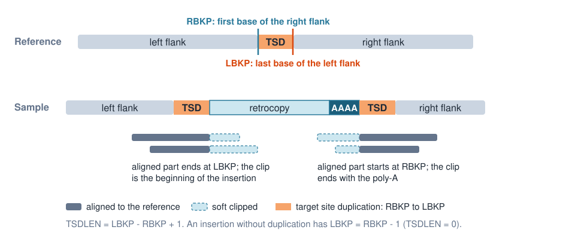

.. _chap_output:

******
Output
******

The last step, ``make-vcf``, writes up to **four files** sharing the
same prefix (option ``-p``, *out* by default):

``<prefix>.vcf``
  One line per retrocopy insertion, in the `VCF
  <https://samtools.github.io/hts-specs/VCFv4.2.pdf>`_ format, with
  the annotation at the **INFO** column and the genotype of each
  sample at the **FORMAT** columns.

``<prefix>.rnames.tsv``
  The **reads** used to detect each retrocopy, by sample. So the user
  can go back to the alignment files and check the evidence by
  herself.

``<prefix>.insertions.fa``
  The **predicted sequence** of each retrocopy, in FASTA format.

``<prefix>.primer.fa``
  The **sequences for primer design**: Around the insertion point and
  the exon-exon junctions of each retrocopy, in FASTA format.

The files are tied together by the **retrocopy ID**
(``RTC000001``, ``RTC000002`` ...), which is the ``ID`` column of
the VCF, the first column of the read names file and the header of
each FASTA record. The IDs are assigned by ``merge-call``, so they
are stable for a given database, but **not** across different runs.

The VCF file
============

The header lists the version of **sideRETRO**, the reference genome
and its contigs, the definition of every
INFO and FORMAT field, and finally the column names - with **one
column per sample**, named after the alignment file without its
extension.

Then, each line describes one retrocopy insertion. The fields with
more than one value - gene names, exons and junctions - are lists
separated by **comma**, as usual for VCF: ``PG``, ``PGALT``,
``PGEXONS``, ``EEJLIST``, ``IRLIST``, ``EXONIC``, ``INTRONIC``,
``NEAR`` and ``HALLMARKS``.

+------------+-------------------------------------------------------------+
| Column     | Content                                                     |
+============+=============================================================+
| CHROM      | Chromosome of the insertion                                 |
+------------+-------------------------------------------------------------+
| POS        | The reference base **before** the insertion. When the two   |
|            | breakpoints are known, it is the base before the **TSD**,   |
|            | so the insertion is left aligned, or the base before the    |
|            | deleted ones for a deletion at the target site (``LBKP``)   |
+------------+-------------------------------------------------------------+
| ID         | The retrocopy ID: ``RTC`` followed by six digits            |
+------------+-------------------------------------------------------------+
| REF        | The reference base at POS, or ``N`` without ``-r``          |
+------------+-------------------------------------------------------------+
| ALT        | ``<INS:ME:RTC>``: A **symbolic** allele for the insertion   |
|            | of a retrocopy. See the note below                          |
+------------+-------------------------------------------------------------+
| QUAL       | Phred scaled probability that the insertion is not real,    |
|            | from the genotype likelihoods, see :ref:`QUAL <qual>`       |
+------------+-------------------------------------------------------------+
| FILTER     | The checks that failed, separated by ``;``, or ``PASS``     |
|            | for a well defined insertion point, see                     |
|            | :ref:`FILTER <filter>`                                      |
+------------+-------------------------------------------------------------+
| INFO       | The annotation, see :ref:`INFO fields <info_fields>`        |
+------------+-------------------------------------------------------------+
| FORMAT     | ``GT:DP2:GL``, followed by one column per sample, see       |
|            | :ref:`FORMAT fields <format_fields>`                        |
+------------+-------------------------------------------------------------+

.. note::
   Why a **symbolic** ALT instead of the inserted sequence? Because
   the retrocopy sequence is **predicted** from the reference exons
   of the parental gene between the observed ends - it is not
   assembled from the reads. A sequence at the ALT column would be
   read by other tools as a precisely observed allele, which we
   cannot claim for the body of the insertion. The **observed** ends
   are at ``LEFT_SVINSSEQ`` and ``RIGHT_SVINSSEQ``, and the predicted
   sequence is at :ref:`the insertions file <insertions_file>`.

.. _qual:

QUAL
----

``QUAL`` is the Phred scaled probability that the site is **not**
variant: :math:`QUAL = -10 \log_{10} P(\text{all samples are } 0/0)`.
With a flat prior, each sample is homozygous reference with probability
:math:`L(0/0) / (L(0/0) + L(0/1) + L(1/1))`, from its genotype likelihoods
(``GL``). Samples without reads are not informative and are skipped; with
no informative sample, ``QUAL`` is ``.``. It is capped at 999.

.. note::
   ``QUAL`` inherits the :ref:`genotype model <method_genotype>`, which
   counts reads weighted by their mapping quality. It is a model based
   score, useful to **rank** the insertions, not a calibrated probability.

.. _filter:

FILTER
------

The ``FILTER`` column tells whether the insertion point is **well defined**:
A ``PASS`` retrocopy is a good target for **validation** (e.g. by PCR). It
lists the checks that failed, separated by ``;``, or ``PASS`` when all of
them passed.

The **target site** is the reference here. It needs the **left** and the
**right** breakpoints, which tell what happened at it (``TSITE``): A
duplication, a blunt insertion or a deletion - all of them valid. So a
retrocopy with a single breakpoint fails ``OneBreakpoint``, and one with
none fails ``NoBreakpoint``. ``LowSR`` counts all the split reads, at any
side: A retrocopy may have many of them at a single breakpoint, passing
``LowSR`` and failing ``OneBreakpoint``.

+-------------------+-------------------------------------------------------+
| LowQual           | ``QUAL`` below the threshold (``make-vcf -L``,        |
|                   | default 20)                                           |
+-------------------+-------------------------------------------------------+
| LowMAPQ           | Mean mapping quality of the supporting reads below    |
|                   | the threshold (``make-vcf -Q``, default 20). Typical  |
|                   | of reads in repeats or paralogs                       |
+-------------------+-------------------------------------------------------+
| AmbiguousParental | The parental gene is ambiguous: ``PGTYPE`` is not 1,  |
|                   | and no gene was chosen among overlapped ones          |
|                   | (no ``PGALT``)                                        |
+-------------------+-------------------------------------------------------+
| LowSR             | Fewer split reads at the breakpoints (``SR``) than    |
|                   | the threshold (``make-vcf -S``, default 3), whatever  |
|                   | their side                                            |
+-------------------+-------------------------------------------------------+
| NoBreakpoint      | No breakpoint found: The insertion point is           |
|                   | imprecise (``IMPRECISE``)                             |
+-------------------+-------------------------------------------------------+
| OneBreakpoint     | Only one breakpoint found: The target site is not     |
|                   | described                                             |
+-------------------+-------------------------------------------------------+
| TSDOutlier        | The target site duplication is longer than the        |
|                   | maximum (``make-vcf -T``, default 25) - probably      |
|                   | breakpoints of unrelated reads. Blunt insertions and  |
|                   | deletions are not checked: A deletion longer than the |
|                   | cluster window splits the insertion in two            |
+-------------------+-------------------------------------------------------+

The poly-A tail, the exon-exon junctions and the orientation are **reported**
(``HALLMARKS``, ``POLYA``, ``POLYASTRAND``, ``EEJ``, ``POLARITY``), but they
do not filter: In short reads, their absence is weak evidence against a
retrocopy.

.. note::
   Alignments without soft clipping (e.g. ``bwa aln``, or an aligner at
   end-to-end mode) have no split reads, so no breakpoint is found. For
   them, turn off ``NoBreakpoint``, ``OneBreakpoint`` and ``LowSR``
   (``make-vcf -x``), or only ``OneBreakpoint`` to accept a single
   breakpoint if there are some clipped reads.

Any filter can be turned off with ``make-vcf -x`` (it may be passed more than
once), and the filters are applied by ``make-vcf``, so trying other thresholds
takes seconds - there is no need to run ``merge-call`` again. The high
confidence set is then::

   $ bcftools view -f PASS out.vcf

.. note::
   Failing a filter does not make an insertion false: Its insertion point
   is just not as well defined. Some genuine retrocopies are inserted without
   a TSD, or have too few reads at the junctions. The filters point out what
   is missing, and ``HALLMARKS`` tells what was observed - the choice is up
   to you.

Precise and imprecise insertions
--------------------------------

The insertion point comes from the **clipped reads** crossing the
junctions between the genome and the retrocopy (see
:ref:`Breakpoints <method_breakpoints>`). When there is at least one
breakpoint, the retrocopy is **precise**: ``POS`` is the base before
the breakpoint and the ``SR`` field counts the supporting reads.

When there is no breakpoint at all - for instance, with low coverage
or when the aligner does not produce clipped alignments, as ``bwa
aln`` - the retrocopy is flagged as ``IMPRECISE``: ``POS`` is the
**mean** of the cluster window, whose limits relative to ``POS`` are
given by ``CIPOS``. All the annotation that depends on the junctions
(breakpoints, TSD, poly-A, retrocopy ends) is absent in that case.

.. _info_fields:

INFO fields
-----------

The fields are grouped by subject. Fields without a value are
**flags**: Their presence is the information.

**Site**

+------------+--------------------------------------------------------------+
| SVTYPE     | Always ``INS``                                               |
+------------+--------------------------------------------------------------+
| IMPRECISE  | Flag. No clipped read defines the insertion point, see above |
+------------+--------------------------------------------------------------+
| CIPOS      | Confidence interval around POS for imprecise insertions:     |
|            | The cluster window limits relative to POS                    |
+------------+--------------------------------------------------------------+
| DP         | Number of abnormal reads clustered at the insertion site,    |
|            | all samples together                                         |
+------------+--------------------------------------------------------------+
| SR         | Number of clipped reads supporting the breakpoints (left     |
|            | plus right). Only for precise insertions                     |
+------------+--------------------------------------------------------------+

**Breakpoints and target site duplication**

+----------------+----------------------------------------------------------+
| LBKP           | **Left breakpoint**: The last reference base of the left |
|                | flank, from the reads clipped at their right side        |
+----------------+----------------------------------------------------------+
| LSR            | Number of reads supporting LBKP                          |
+----------------+----------------------------------------------------------+
| RBKP           | **Right breakpoint**: The first reference base of the    |
|                | right flank, from the reads clipped at their left side   |
+----------------+----------------------------------------------------------+
| RSR            | Number of reads supporting RBKP                          |
+----------------+----------------------------------------------------------+
| TSDLEN         | Length of the **target site duplication**:               |
|                | ``LBKP - RBKP + 1``. Positive for a duplication, zero    |
|                | for a blunt insertion and negative for a deletion at the |
|                | target site, of ``-TSDLEN`` bases. Needs both            |
|                | breakpoints. See :ref:`Breakpoints <method_breakpoints>` |
+----------------+----------------------------------------------------------+
| TSITE          | **Target site** of the insertion, given by both          |
|                | breakpoints: ``DUP`` (duplication, ``TSDLEN > 0``),      |
|                | ``BLUNT`` (blunt insertion, ``TSDLEN = 0``) or ``DEL``   |
|                | (deletion, ``TSDLEN < 0``)                               |
+----------------+----------------------------------------------------------+
| TSITEMERGED    | A **deletion** at the target site longer than the        |
|                | cluster window: The insertion was merged from the        |
|                | retrocopies at its two flanks (``merge-call -D``). See   |
|                | :ref:`Long deletions <method_tsite_merged>`              |
+----------------+----------------------------------------------------------+
| TSD            | The TSD sequence: The reference bases from RBKP to LBKP. |
|                | Needs ``-r`` and ``0 < TSDLEN <= 100``                   |
+----------------+----------------------------------------------------------+
| LEFT_SVINSSEQ  | **Observed** sequence of the insertion at the left       |
|                | junction: The consensus of the clipped reads at LBKP,    |
|                | read from the junction into the insertion. A base where  |
|                | the reads tie is ``N``                                   |
+----------------+----------------------------------------------------------+
| RIGHT_SVINSSEQ | Observed sequence at the right junction: The consensus   |
|                | of the clipped reads at RBKP, ending at the junction.    |
|                | A base where the reads tie is ``N``                      |
+----------------+----------------------------------------------------------+

A retrocopy with a TSD looks like this at the reference and at the
sequenced genome:

The reads from the left flank cross the junction after the **last**
base of the TSD (``LBKP``), while the reads from the right flank
cross it before the **first** base of the TSD (``RBKP``). That is
why ``RBKP`` comes **before** ``LBKP`` at the reference when there
is a duplication.

**Poly-A tail and polarity**

+-------------+--------------------------------------------------------------+
| POLYA       | Length of the poly-A tail observed in the reads crossing     |
|             | its junction. Genomic A bases adjacent to the tail cannot    |
|             | be told apart from it, so the run is reported as seen        |
+-------------+--------------------------------------------------------------+
| POLYAMIN    | Flag. POLYA is a **lower bound**: The tail extends beyond    |
|             | the longest clipped read                                     |
+-------------+--------------------------------------------------------------+
| POLYASR     | Number of reads supporting the poly-A                        |
+-------------+--------------------------------------------------------------+
| POLYASTRAND | Strand of the retrocopy given by the poly-A junction         |
|             | (``+``/``-``): The tail is at the right junction for ``+``   |
|             | and, reverse complemented, at the left junction for ``-``.   |
|             | Independent of POLARITY: They may disagree                   |
+-------------+--------------------------------------------------------------+
| POLARITY    | Orientation of the event at the reference (``+``/``-``),     |
|             | from ORHO                                                    |
+-------------+--------------------------------------------------------------+
| ORHO        | Spearman's rho between the positions of the reads at the     |
|             | parental gene and of their mates at the insertion site, see  |
|             | :ref:`Orientation <method_orientation>`. Only when the test  |
|             | is significant (``make-vcf -e``)                             |
+-------------+--------------------------------------------------------------+

**Hallmarks**

+------------+--------------------------------------------------------------+
| HALLMARKS  | The retrocopy hallmarks observed, separated by comma: ``TSD``|
|            | (target site duplication), ``POLYA`` (poly-A tail) and       |
|            | ``EEJ`` (exon-exon junctions). The poly-A and the junctions  |
|            | do not filter: They are reported for you to judge            |
+------------+--------------------------------------------------------------+

**Parental gene**

+------------+--------------------------------------------------------------+
| PG         | Parental gene name(s)                                        |
+------------+--------------------------------------------------------------+
| PGALT      | Gene name(s) overlapping the parental gene. When it is       |
|            | present, ``PG`` was **chosen** among overlapped genes, see   |
|            | :ref:`Overlapped parental genes <method_overlapped>`         |
+------------+--------------------------------------------------------------+
| PGTYPE     | How the parental gene was resolved: ``1`` single parental    |
|            | gene; ``2`` overlapped parental genes (one of them chosen if |
|            | there is ``PGALT``); ``4`` near parental genes; ``8``        |
|            | hotspot - multiple parental genes with retrocopies at the    |
|            | same segment. Values may be summed                           |
+------------+--------------------------------------------------------------+
| PGEXONS    | Number of exons of each parental gene, as ``gene:n``. A      |
|            | **single exon** gene has no exon-exon junction, so a missing |
|            | EEJ is expected for it                                       |
+------------+--------------------------------------------------------------+
| EEJ        | Number of **exon-exon junctions** of the parental gene       |
|            | spanned by split reads: Direct evidence of a processed       |
|            | transcript. The reads are at the read names file and at the  |
|            | primer file                                                  |
+------------+--------------------------------------------------------------+
| EEJLIST    | The junctions spanned, as ``exon_id1-exon_id2``. With        |
|            | alternative exons, it tells which isoform was retrocopied    |
+------------+--------------------------------------------------------------+
| IR         | **Intron retention**: Number of reads at the insertion whose |
|            | mate is inside an intron of the parental gene, summed over   |
|            | the introns at ``IRLIST``, see :ref:`Intron retention        |
|            | <method_intron>`                                             |
+------------+--------------------------------------------------------------+
| IRLIST     | The introns retained, as                                     |
|            | ``exon_id_left-exon_id_right:reads`` - the exons at the left |
|            | and right of the intron, by their coordinates, and its       |
|            | reads. An intron needs a sample with ``make-vcf --min-ir``   |
|            | reads                                                        |
+------------+--------------------------------------------------------------+

.. note::
   The exon ids at ``EEJLIST``, ``IRLIST``, ``PG5P`` and ``PG3P`` come from the annotation.
   When the annotation has no exon ids - a BED6 file, for instance - they are the
   exon coordinates, ``chr:start_end`` - e.g.
   ``EEJLIST=chr2:1001_1400-chr2:2001_2400`` - see :ref:`Annotation formats <annotation>`.

**Retrocopy ends and length** (need ``merge-call -r``)

+------------+--------------------------------------------------------------+
| PG5P       | The **5' end** of the retrocopy into the parental gene, as   |
|            | ``exon_id:position:reads``. The position is at the reference |
|            | genome. A 5' end inside the transcript means a **5'**        |
|            | **truncated** retrocopy                                      |
+------------+--------------------------------------------------------------+
| PG3P       | The **3' end**, before the poly-A, as                        |
|            | ``exon_id:position:reads``                                   |
+------------+--------------------------------------------------------------+
| SVLEN      | **Predicted** length of the insertion: The reference exon    |
|            | bases between the ends plus the poly-A. When PG3P is not     |
|            | observed, the 3' end is assumed at the end of the last exon  |
+------------+--------------------------------------------------------------+

**Genomic context**

+------------+--------------------------------------------------------------+
| EXONIC     | Host gene(s) when the insertion falls inside an exon         |
+------------+--------------------------------------------------------------+
| INTRONIC   | Host gene(s) when the insertion falls inside a gene, but not |
|            | at this gene exons                                           |
+------------+--------------------------------------------------------------+
| NEAR       | Gene(s) near the insertion, within ``make-vcf -n`` bases,    |
|            | for intergenic insertions                                    |
+------------+--------------------------------------------------------------+

.. _format_fields:

FORMAT fields
-------------

One column per sample, with:

+------------+--------------------------------------------------------------+
| GT         | Genotype: ``0/0`` homozygous reference, ``0/1``              |
|            | heterozygous, ``1/1`` homozygous alternate or ``./.`` when   |
|            | the likelihoods cannot decide                                |
+------------+--------------------------------------------------------------+
| DP2        | Read depth at this sample: Reference depth and alternate     |
|            | depth, separated by comma                                    |
+------------+--------------------------------------------------------------+
| GL         | Genotype likelihoods (log10) for ``0/0``, ``0/1`` and        |
|            | ``1/1``, see :ref:`Genotype <method_genotype>`               |
+------------+--------------------------------------------------------------+

An example
----------

The line below comes from the :ref:`simulated data <sim_test>`
shipped with **sideRETRO**: A retrocopy of the gene *PARENT*,
inserted at *chr1* with a 12 bases TSD and a 25 bases poly-A tail.
The INFO column was wrapped for reading::

   chr1  9999  RTC000001  A  <INS:ME:RTC>  999.0  PASS
     SVTYPE=INS;ORHO=0.514382;POLARITY=+;PG=PARENT;PGTYPE=1;PGEXONS=PARENT:3;
     HALLMARKS=TSD,POLYA,EEJ;EEJ=1;EEJLIST=ENSEP0-ENSEP1;PG5P=ENSEP0:1001:8;PG3P=ENSEP2:3398:3;SVLEN=1225;
     LEFT_SVINSSEQ=CACTGATACAGCAGACTCATTCCCCTATAAGCGAATCGTA;
     RIGHT_SVINSSEQ=ACTCAGCAGGACTCGGTTTAAAAAAAAAAAAAAAAAAAAAAAAAAA;
     DP=42;SR=16;LBKP=10011;LSR=8;RBKP=10000;RSR=8;TSDLEN=12;TSD=GAACGCCCCGTG;
     POLYA=27;POLYASR=8;POLYASTRAND=+
     GT:DP2:GL  1/1:0,42:-253,-12.6,-1.8e-05

Reading it: The insertion is **precise** (no ``IMPRECISE``), with 8
reads at each breakpoint (``LSR``, ``RSR``) and a TSD of 12 bases
(``TSDLEN``, ``TSD``). The poly-A has 27 bases - 25 simulated plus
two A at the end of the last exon - and puts the retrocopy at the
``+`` strand. Reads span one junction, between the first two exons
(``EEJ``, ``EEJLIST``), the retrocopy is **full length** (``PG5P`` at
the first base of exon *ENSEP0*) and its predicted length is 1225
bases: Three exons of 400 bases plus the poly-A. The single sample is
homozygous for the insertion, hence the maximum ``QUAL``, and the insertion
has all the hallmarks of a retrocopy (``HALLMARKS``), so it passes all the
filters (``PASS``).

.. _rnames_file:

The read names file
===================

A tab separated file with **one read per line**: The retrocopy ID, the
sample, the read name and its **role** in the evidence, after a header
line::

   #retrocopy_id	sample	read_name	role
   RTC000001	NA12878	A00123:45:HV7KJDSXY:1:1101:12345:6789	discordant
   RTC000001	NA12878	A00123:45:HV7KJDSXY:1:1102:2210:1003	split_left
   RTC000001	NA12878	A00123:45:HV7KJDSXY:1:1203:7781:2004	split_right,polya
   RTC000001	NA12778	A00456:12:HT2LMDSXY:2:2201:8812:4410	junction

Samples are named as in the VCF header. The file follows the VCF order and,
for each retrocopy and sample, the reads are sorted by name. These are the
**abnormal reads** clustered at the insertion site - exactly the evidence that
called the retrocopy. Each read name stands for the **fragment** (the read and
its mate), and its roles are:

+-------------+-------------------------------------------------------------+
| split_left  | Clipped at the accepted **left breakpoint** (counted at     |
|             | ``LSR``)                                                    |
+-------------+-------------------------------------------------------------+
| split_right | Clipped at the accepted **right breakpoint** (counted at    |
|             | ``RSR``)                                                    |
+-------------+-------------------------------------------------------------+
| polya       | Its clip has the **poly-A** tail (counted at ``POLYASR``)   |
+-------------+-------------------------------------------------------------+
| junction    | Spans an **exon-exon junction** of the parental gene        |
|             | (its junction is counted at ``EEJ``)                        |
+-------------+-------------------------------------------------------------+
| discordant  | None of the above: A read at the insertion site whose mate  |
|             | falls into the parental gene                                |
+-------------+-------------------------------------------------------------+

A read may have more than one role, separated by comma - a read clipped at
the right breakpoint whose clip ends with the poly-A is ``split_right,polya``.
Only the reads supporting the **accepted** breakpoints are split reads: A read
clipped somewhere else, by an adapter for instance, is ``discordant``.

A read name never has a tab (see the `SAM specification
<https://samtools.github.io/hts-specs/SAMv1.pdf>`_), so the names are written
as they are - with the colons of Illumina, for instance - and the file can be
read by any tool, with no escaping. To inspect the reads crossing the left
breakpoint of a retrocopy in a sample::

   $ awk -F'\t' '$1 == "RTC000001" && $2 == "NA12878" && $4 ~ /split_left/ {print $3}' \
       out.rnames.tsv > reads.txt
   $ samtools view -N reads.txt NA12878.bam

In R or Python, read it as any table and group it by ``retrocopy_id`` and
``sample``::

   >>> import pandas as pd
   >>> rnames = pd.read_csv('out.rnames.tsv', sep='\t')
   >>> rnames.groupby(['#retrocopy_id', 'sample', 'role']).size()

.. _insertions_file:

The predicted insertions file
=============================

A FASTA file with one record per retrocopy whose **5' end** was found
(so it needs ``merge-call -r``)::

   >RTC000001 chr1:9999 PG=PARENT SVLEN=1225 predicted
   CACTGATACAGCAGACTCATTCCCCTATAAGCGAATCGTAAATTATAACCGTCATGAGGA
   ...

The header carries the ID, the insertion site, the parental gene and
the length. The sequence is written in the **mRNA sense** (5' to
3'), whatever the strand of the insertion, and it is made of:

- the reference bases of the parental exons from the 5' end (PG5P)
  to the 3' end (PG3P, or the end of the last exon when not
  observed), skipping the introns;
- the poly-A tail, with the observed length (POLYA).

The word *predicted* in the header is deliberate: The **junctions**
and the **poly-A** are observed in the reads, the **body** between
them is taken from the reference. It is right whenever the retrocopy
copied the annotated exons faithfully, and it says nothing about
variants carried from the parental allele, mutations acquired since
the insertion or unannotated isoforms. Use it as a template, not as
an assembly.

.. _primer_file:

The primer file
===============

A retrocopy is usually validated by **PCR**, with two kinds of
amplicon: One across the **insertion site**, which proves the
insertion and tells the alleles apart, and another across an
**exon-exon junction**, which proves that the copy came from a
processed transcript - the parental gene has an intron there. The
primer file gives the template sequences for both, ready for a
primer design tool.

There are up to four kinds of record for each retrocopy with **at
least one breakpoint**, named after the retrocopy ID::

   >RTC000001_empty chr1:9800-10211 PG=PARENT FILTER=PASS junction=200
   GATCGTTATGTTACGGACGGACGGCGGCGCATAACGCTCCTTCTGACGCTCTGTACCGAG
   ...
   >RTC000001_left chr1:9812-10011 PG=PARENT FILTER=PASS junction=200
   ...
   >RTC000001_right chr1:10000-10199 PG=PARENT FILTER=PASS junction=46
   ...
   >RTC000001_eej1 chr2:1201-1400,2001-2200 PG=PARENT FILTER=PASS junction=200 strand=+ reads=6
   ...

+------------+--------------------------------------------------------------+
| Record     | Sequence                                                     |
+============+==============================================================+
| ``_empty`` | The allele **without** the insertion, from the reference:    |
|            | The left flank, the target site duplication and the right    |
|            | flank. Without TSD, the bases between the breakpoints (if    |
|            | any) take its place. It is not written when the breakpoints  |
|            | are inconsistent                                             |
+------------+--------------------------------------------------------------+
| ``_left``  | The left flank, up to ``LBKP``, followed by the observed     |
|            | start of the insertion (``LEFT_SVINSSEQ``)                   |
+------------+--------------------------------------------------------------+
| ``_right`` | The observed end of the insertion (``RIGHT_SVINSSEQ``)       |
|            | followed by the right flank, from ``RBKP``                   |
+------------+--------------------------------------------------------------+
| ``_eejN``  | An exon-exon junction spanned by the reads: The end of one   |
|            | exon followed by the start of the next one, from the         |
|            | reference                                                    |
+------------+--------------------------------------------------------------+

The header carries the reference range of the record (two ranges for
an exon-exon junction), the parental gene, the ``FILTER`` of the
retrocopy and:

``junction``
  The number of bases **before** the junction: Where the flank meets
  the insertion, where the target site duplication begins or where
  the two exons meet. A primer design tool can take it as the target
  to be amplified.

``strand`` and ``reads``
  Only for the exon-exon junctions: The strand of the parental gene
  and the number of reads spanning the junction.

Some notes:

- Each flank has 200 bases by default (option ``-f``,
  ``--primer-flank``). The flank of an exon-exon junction never goes
  beyond its exon, so it may be shorter.
- The ``_empty``, ``_left`` and ``_right`` records are at the
  **forward strand of the reference**. The exon-exon junctions are at
  the **strand of the parental gene** (mRNA sense).
- The sequences are in upper case: The junction is given at the
  header, not by the case of the bases, which some tools read as
  masked sequence.
- Exons of different transcripts may share the boundaries of a
  junction. The junction is named after one of them (``EEJLIST``),
  but its flanks come from the **longest** of them.
- A retrocopy with one breakpoint has only the records of that side,
  and many retrocopies have no exon-exon junction observed.
- The observed sequences may have ``N`` where the reads disagree, and
  the exon-exon junctions come from the annotation: They are as good
  as the exons annotated.
- All the retrocopies are written, not only the ``PASS`` ones: Filter
  them by the ``FILTER`` at the header.
